Work through the examples in order, run the experiments, and write your own interpretations in the answer spaces. All plots use `ggplot2`. Built-in and simulated datasets run without downloading data. The Japan example uses the CSV included beside this document.

## What changes at a structural break?

A structural break changes the relationship generating a series. A one-off outlier, a persistent level shift, a change in slope, a new variance and a changed seasonal pattern call for different models. An event date is a candidate explanation, not proof of a causal effect.

| Example | Data | Main question |
|------------------------|------------------------|------------------------|
| Intervention shapes | Simulated | Pulse, temporary shift or permanent change? |
| Level shift | `Nile` | Did the mean change? |
| Trend change | Simulated | Did growth change without a sudden jump? |
| Variance change | Simulated | Did uncertainty change while the mean stayed fixed? |
| Seasonal change | Simulated | Did the seasonal amplitude change? |
| Policy intervention | `Seatbelts` | How do controls and correlated errors affect estimates? |
| Apparent instability | `AirPassengers` | Would a transformation explain the changing spread? |
| Forecasting case study | JNTO arrivals | Does modelling breaks improve held-out forecasts? |


::: {.cell}

```{.r .cell-code}
# Install once if needed:
# install.packages(c("ggplot2", "dplyr", "tidyr", "readr", "forecast", "tsibble"))
library(ggplot2)
library(dplyr)
library(tidyr)
library(readr)
library(forecast)
theme_set(theme_minimal(base_size = 12))
set.seed(4010)
```
:::


## Recognise the intervention shapes

At the first affected observation, a step becomes one. A ramp starts at zero and then increases: it changes slope while keeping the fitted curve continuous. Add both to allow a jump and a slope change.


::: {.cell}

```{.r .cell-code}
shapes <- data.frame(t = 1:120) |>
  mutate(Pulse = as.integer(t == 61),
         Step = as.integer(t >= 61),
         Ramp = pmax(0, t - 61),
         Temporary = as.integer(t >= 61 & t <= 85)) |>
  pivot_longer(-t, names_to = "type", values_to = "value")
ggplot(shapes, aes(t, value)) + geom_line() +
  geom_vline(xintercept = 61, linetype = 2) +
  facet_wrap(~type, scales = "free_y") +
  labs(x = "Observation", y = "Intervention value")
```

::: {.cell-output-display}
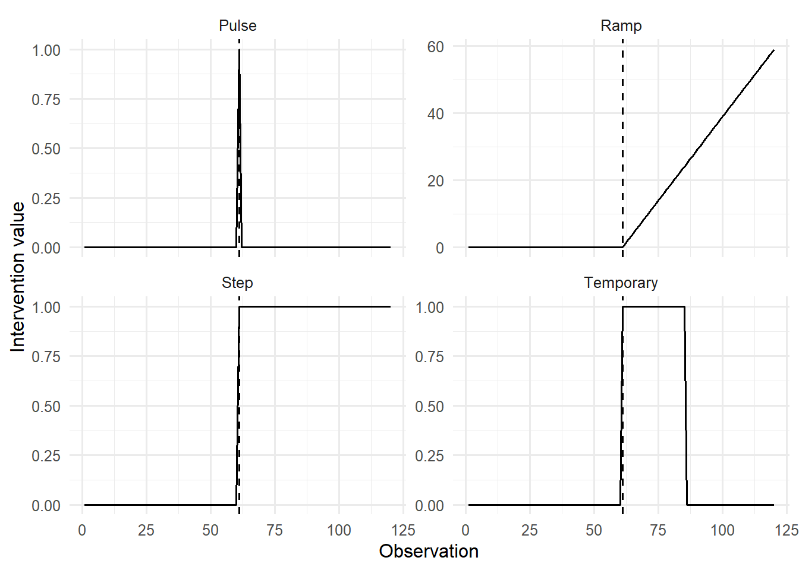{width=672}
:::
:::


**Try:** Move the break to observation 40. How does a pulse differ from a temporary shift lasting 25 observations?

**Your answer:**


::: {.cell}

```{.r .cell-code}
shapes <- data.frame(t = 1:120) |>
  mutate(Pulse = as.integer(t == 41),
         Step = as.integer(t >= 41),
         Ramp = pmax(0, t - 41),
         Temporary = as.integer(t >= 41 & t <= 65)) |>
  pivot_longer(-t, names_to = "type", values_to = "value")
ggplot(shapes, aes(t, value)) + geom_line() +
  geom_vline(xintercept = 41, linetype = 2) +
  facet_wrap(~type, scales = "free_y") +
  labs(x = "Observation", y = "Intervention value")
```

::: {.cell-output-display}
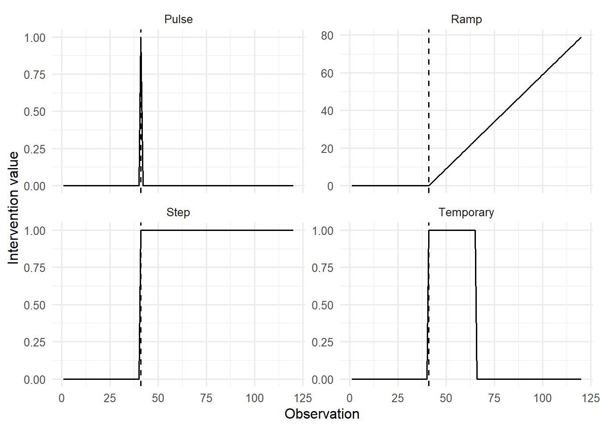{width=672}
:::
:::


The pulse is a short structural break where the intervention value increases at a single point in time and then immediately decreases back to its original level. This represents a one-off shock to the series.

A temporary break lasts for a longer period. The intervention value increases at observation 41 and stays constant at this new level until observation 65, after which it decreases back to its original level. Therefore, unlike a pulse, which only affects one observation, a temporary break affects the series for a specified period before returning to the original level.

## A level shift: annual Nile flows

R's documentation describes `Nile` as annual flow at Aswan, 1871–1970, with an apparent change point near 1898. First inspect the plot without imposing that date. [Dataset documentation](https://stat.ethz.ch/R-manual/R-devel/library/datasets/html/Nile.html).


::: {.cell}

```{.r .cell-code}
nile <- data.frame(year = as.numeric(time(Nile)), flow = as.numeric(Nile))
ggplot(nile, aes(year, flow)) + geom_line() +
  labs(x = "Year", y = expression(Flow~(10^8~m^3)))
```

::: {.cell-output-display}
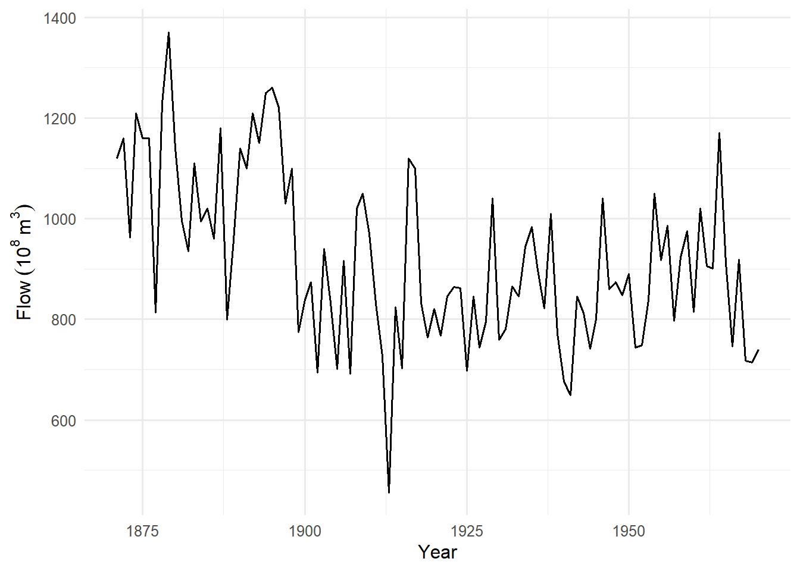{width=672}
:::

```{.r .cell-code}
# Search over one unknown break. b is the LAST observation of regime 1.
scan_level <- function(y, minimum = 15) {
  n <- length(y)
  stopifnot(n >= 2 * minimum, all(is.finite(y)))
  candidates <- minimum:(n - minimum)
  data.frame(last_before = candidates,
    RSS = vapply(candidates, function(b) {
      sum((y[1:b] - mean(y[1:b]))^2) +
        sum((y[(b + 1):n] - mean(y[(b + 1):n]))^2)
    }, numeric(1)))
}
scan_nile <- scan_level(nile$flow)
b_nile <- scan_nile$last_before[which.min(scan_nile$RSS)]
first_year <- nile$year[b_nile + 1]
first_year
```

::: {.cell-output .cell-output-stdout}

```
[1] 1899
```


:::

```{.r .cell-code}
nile$after <- as.integer(nile$year >= first_year)
nile_stable <- lm(flow ~ 1, data = nile)
nile_shift <- lm(flow ~ after, data = nile)
summary(nile_shift)
```

::: {.cell-output .cell-output-stdout}

```

Call:
lm(formula = flow ~ after, data = nile)

Residuals:
    Min      1Q  Median      3Q     Max 
-393.97  -93.47   -2.97   70.03  320.03 

Coefficients:
            Estimate Std. Error t value Pr(>|t|)    
(Intercept)  1097.75      24.13  45.497  < 2e-16 ***
after        -247.78      28.44  -8.714 7.44e-14 ***
---
Signif. codes:  0 '***' 0.001 '**' 0.01 '*' 0.05 '.' 0.1 ' ' 1

Residual standard error: 127.7 on 98 degrees of freedom
Multiple R-squared:  0.4366,	Adjusted R-squared:  0.4308 
F-statistic: 75.93 on 1 and 98 DF,  p-value: 7.439e-14
```


:::

```{.r .cell-code}
data.frame(model = c("Stable mean", "One selected level shift"),
           BIC = c(BIC(nile_stable), BIC(nile_shift)))
```

::: {.cell-output .cell-output-stdout}

```
                     model      BIC
1              Stable mean 1318.242
2 One selected level shift 1265.479
```


:::

```{.r .cell-code}
nile$fitted <- fitted(nile_shift)
ggplot(nile, aes(year, flow)) + geom_line(colour = "grey50") +
  geom_line(aes(y = fitted), colour = "steelblue", linewidth = 1) +
  geom_vline(xintercept = first_year, linetype = 2) +
  labs(y = expression(Flow~(10^8~m^3)), x = "Year")
```

::: {.cell-output-display}
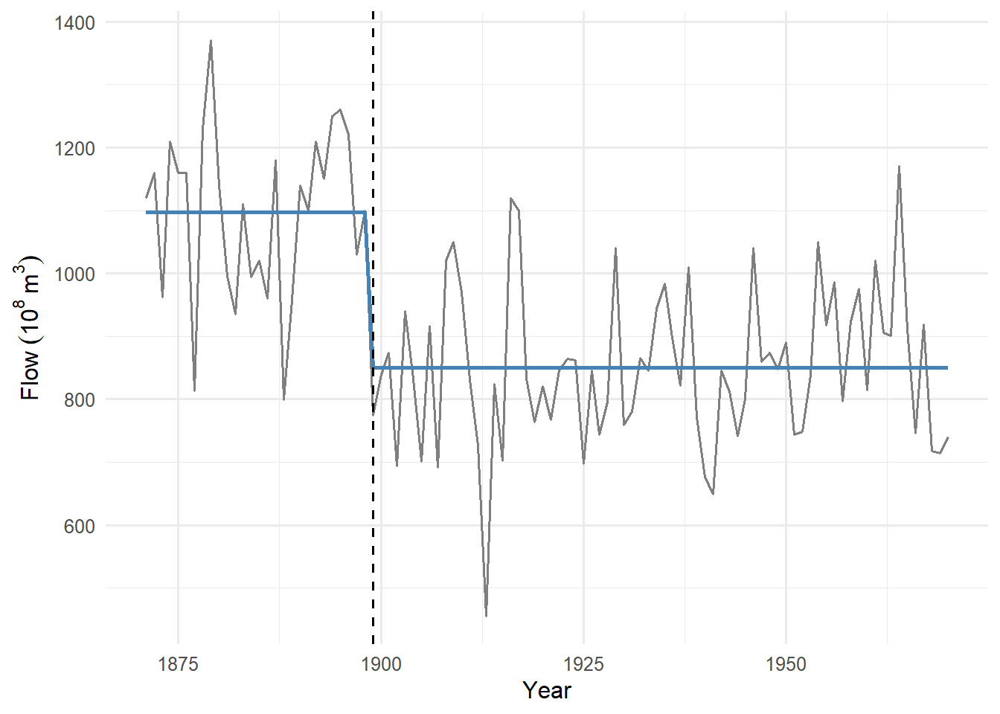{width=672}
:::

```{.r .cell-code}
ggplot(scan_nile, aes(nile$year[last_before + 1], RSS)) +
  geom_line() + labs(x = "First year after candidate break", y = "Residual sum of squares")
```

::: {.cell-output-display}
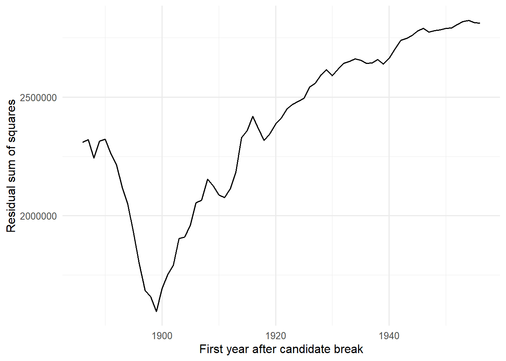{width=672}
:::
:::


This scan finds the best location **conditional on allowing one break**. The displayed regression BIC treats the selected date as fixed; it does not fully penalise searching for the date. Ordinary coefficient p-values after searching are also optimistic. Use the profile to explore sensitivity, and use a formal break procedure or forecasting validation before a final claim.

**Try:** Repeat with minimum segment lengths of 10, 20 and 30. Compare `acf(residuals(nile_stable))` and `acf(residuals(nile_shift))`. Can an unmodelled shift make a series look persistent?

**Your answer:**


::: {.cell}

```{.r .cell-code}
library(patchwork)
# minimum length 10
scan_level <- function(y, minimum = 10) {
  n <- length(y)
  stopifnot(n >= 2 * minimum, all(is.finite(y)))
  candidates <- minimum:(n - minimum)
  data.frame(last_before = candidates,
             RSS = vapply(candidates, function(b) {
               sum((y[1:b] - mean(y[1:b]))^2) +
                 sum((y[(b + 1):n] - mean(y[(b + 1):n]))^2)
             }, numeric(1)))
}
scan_nile <- scan_level(nile$flow)
b_nile <- scan_nile$last_before[which.min(scan_nile$RSS)]
first_year <- nile$year[b_nile + 1]
first_year
```

::: {.cell-output .cell-output-stdout}

```
[1] 1899
```


:::

```{.r .cell-code}
nile$after <- as.integer(nile$year >= first_year)
nile_stable <- lm(flow ~ 1, data = nile)
nile_shift <- lm(flow ~ after, data = nile)
min10_stable<- acf(residuals(nile_stable))
```

::: {.cell-output-display}
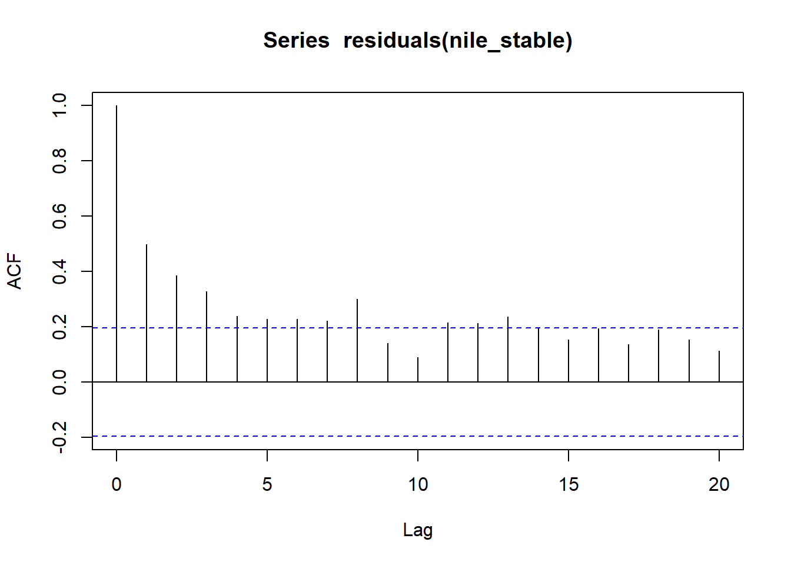{width=672}
:::

```{.r .cell-code}
min10_shift <- acf(residuals(nile_shift))
```

::: {.cell-output-display}
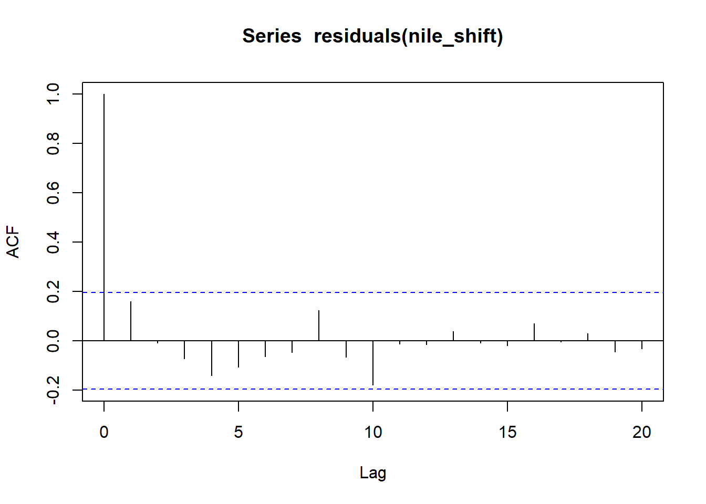{width=672}
:::

```{.r .cell-code}
# minimum 20
scan_level <- function(y, minimum = 20) {
  n <- length(y)
  stopifnot(n >= 2 * minimum, all(is.finite(y)))
  candidates <- minimum:(n - minimum)
  data.frame(last_before = candidates,
             RSS = vapply(candidates, function(b) {
               sum((y[1:b] - mean(y[1:b]))^2) +
                 sum((y[(b + 1):n] - mean(y[(b + 1):n]))^2)
             }, numeric(1)))
}
scan_nile <- scan_level(nile$flow)
b_nile <- scan_nile$last_before[which.min(scan_nile$RSS)]
first_year <- nile$year[b_nile + 1]
first_year
```

::: {.cell-output .cell-output-stdout}

```
[1] 1899
```


:::

```{.r .cell-code}
nile$after <- as.integer(nile$year >= first_year)
nile_stable <- lm(flow ~ 1, data = nile)
nile_shift <- lm(flow ~ after, data = nile)
min20_stable<- acf(residuals(nile_stable))
```

::: {.cell-output-display}
{width=672}
:::

```{.r .cell-code}
min20_shift <- acf(residuals(nile_shift))
```

::: {.cell-output-display}
{width=672}
:::

```{.r .cell-code}
# minimum 30 
scan_level <- function(y, minimum = 30) {
  n <- length(y)
  stopifnot(n >= 2 * minimum, all(is.finite(y)))
  candidates <- minimum:(n - minimum)
  data.frame(last_before = candidates,
             RSS = vapply(candidates, function(b) {
               sum((y[1:b] - mean(y[1:b]))^2) +
                 sum((y[(b + 1):n] - mean(y[(b + 1):n]))^2)
             }, numeric(1)))
}
scan_nile <- scan_level(nile$flow)
b_nile <- scan_nile$last_before[which.min(scan_nile$RSS)]
first_year <- nile$year[b_nile + 1]
first_year
```

::: {.cell-output .cell-output-stdout}

```
[1] 1901
```


:::

```{.r .cell-code}
nile$after <- as.integer(nile$year >= first_year)
nile_stable <- lm(flow ~ 1, data = nile)
nile_shift <- lm(flow ~ after, data = nile)
min30_stable<- acf(residuals(nile_stable))
```

::: {.cell-output-display}
{width=672}
:::

```{.r .cell-code}
min30_shift <- acf(residuals(nile_shift))
```

::: {.cell-output-display}
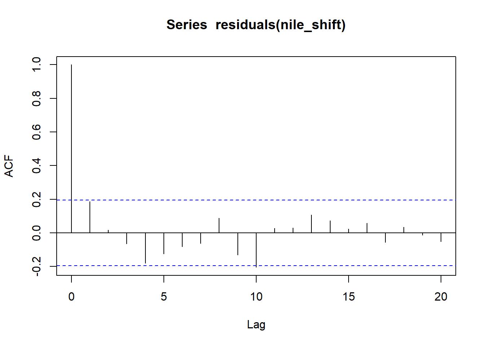{width=672}
:::

```{.r .cell-code}
min10_stable 
```

::: {.cell-output .cell-output-stdout}

```

Autocorrelations of series 'residuals(nile_stable)', by lag

    0     1     2     3     4     5     6     7     8     9    10    11    12 
1.000 0.498 0.385 0.328 0.239 0.228 0.227 0.222 0.300 0.142 0.090 0.215 0.213 
   13    14    15    16    17    18    19    20 
0.237 0.195 0.154 0.195 0.136 0.190 0.154 0.114 
```


:::

```{.r .cell-code}
min10_shift
```

::: {.cell-output .cell-output-stdout}

```

Autocorrelations of series 'residuals(nile_shift)', by lag

     0      1      2      3      4      5      6      7      8      9     10 
 1.000  0.160 -0.008 -0.072 -0.139 -0.107 -0.063 -0.047  0.125 -0.066 -0.179 
    11     12     13     14     15     16     17     18     19     20 
-0.012 -0.015  0.038 -0.009 -0.019  0.071 -0.004  0.031 -0.045 -0.031 
```


:::

```{.r .cell-code}
min20_stable 
```

::: {.cell-output .cell-output-stdout}

```

Autocorrelations of series 'residuals(nile_stable)', by lag

    0     1     2     3     4     5     6     7     8     9    10    11    12 
1.000 0.498 0.385 0.328 0.239 0.228 0.227 0.222 0.300 0.142 0.090 0.215 0.213 
   13    14    15    16    17    18    19    20 
0.237 0.195 0.154 0.195 0.136 0.190 0.154 0.114 
```


:::

```{.r .cell-code}
min20_shift
```

::: {.cell-output .cell-output-stdout}

```

Autocorrelations of series 'residuals(nile_shift)', by lag

     0      1      2      3      4      5      6      7      8      9     10 
 1.000  0.160 -0.008 -0.072 -0.139 -0.107 -0.063 -0.047  0.125 -0.066 -0.179 
    11     12     13     14     15     16     17     18     19     20 
-0.012 -0.015  0.038 -0.009 -0.019  0.071 -0.004  0.031 -0.045 -0.031 
```


:::

```{.r .cell-code}
min30_stable
```

::: {.cell-output .cell-output-stdout}

```

Autocorrelations of series 'residuals(nile_stable)', by lag

    0     1     2     3     4     5     6     7     8     9    10    11    12 
1.000 0.498 0.385 0.328 0.239 0.228 0.227 0.222 0.300 0.142 0.090 0.215 0.213 
   13    14    15    16    17    18    19    20 
0.237 0.195 0.154 0.195 0.136 0.190 0.154 0.114 
```


:::

```{.r .cell-code}
min30_shift
```

::: {.cell-output .cell-output-stdout}

```

Autocorrelations of series 'residuals(nile_shift)', by lag

     0      1      2      3      4      5      6      7      8      9     10 
 1.000  0.186  0.018 -0.064 -0.179 -0.124 -0.082 -0.061  0.088 -0.130 -0.204 
    11     12     13     14     15     16     17     18     19     20 
 0.027  0.029  0.106  0.072  0.024  0.057 -0.056  0.035 -0.013 -0.052 
```


:::
:::


The minimum segment length was changed to 10, 20 and 30 to determine whether changing the minimum number of observations allowed on either side of the structural break would affect the detected break point. The estimated break year remained the same across the different minimum segment lengths. This suggests that the detected structural break is relatively stable and is not sensitive to the choice of minimum segment length.

For each minimum segment length, a stable mean model and a level shift model were fitted. The stable mean model assumes that the mean of the Nile flow remains constant throughout the entire series, while the level shift model allows the mean to change after the detected structural break.

The ACF plots of the residuals were then compared. The stable mean model shows more autocorrelation in the residuals, while the level shift model shows a reduction in the autocorrelation after accounting for the structural break. This suggests that some of the autocorrelation that appears in the stable model may actually be caused by the unmodelled change in the mean rather than only by dependence between observations over time.

Therefore, not accounting for a structural break can make a series appear to have stronger persistence or autocorrelation than it actually has. Once the level shift is included in the model, some of this dependence is removed because the model is able to account for the different mean levels before and after the structural break.

## A trend break without a level jump

Here the true break is known, so you can assess whether your method recovers it. The generating mean is continuous at observation 121.


::: {.cell}

```{.r .cell-code}
set.seed(12)
trend_data <- data.frame(t = 1:240) |>
  mutate(after = as.integer(t >= 121), ramp = pmax(0, t - 121),
         true_mean = 10 + 0.04 * t + 0.12 * ramp,
         y = true_mean + rnorm(n(), sd = 1.3))
m_stable <- lm(y ~ t, data = trend_data)
m_level <- lm(y ~ t + after, data = trend_data)
m_slope <- lm(y ~ t + ramp, data = trend_data)
m_both <- lm(y ~ t + after + ramp, data = trend_data)
data.frame(model = c("Stable trend", "Level only", "Slope only", "Level and slope"),
           BIC = c(BIC(m_stable), BIC(m_level), BIC(m_slope), BIC(m_both)))
```

::: {.cell-output .cell-output-stdout}

```
            model       BIC
1    Stable trend 1105.8140
2      Level only 1111.1000
3      Slope only  800.9949
4 Level and slope  806.0392
```


:::

```{.r .cell-code}
summary(m_slope)
```

::: {.cell-output .cell-output-stdout}

```

Call:
lm(formula = y ~ t + ramp, data = trend_data)

Residuals:
    Min      1Q  Median      3Q     Max 
-3.7718 -0.8183 -0.0640  0.8332  2.7832 

Coefficients:
            Estimate Std. Error t value Pr(>|t|)    
(Intercept) 9.840604   0.211529   46.52   <2e-16 ***
t           0.042182   0.002558   16.49   <2e-16 ***
ramp        0.115127   0.004600   25.03   <2e-16 ***
---
Signif. codes:  0 '***' 0.001 '**' 0.01 '*' 0.05 '.' 0.1 ' ' 1

Residual standard error: 1.234 on 237 degrees of freedom
Multiple R-squared:  0.9716,	Adjusted R-squared:  0.9713 
F-statistic:  4048 on 2 and 237 DF,  p-value: < 2.2e-16
```


:::

```{.r .cell-code}
# With this pre-specified date and independent Gaussian simulation errors,
# the nested-model F test is appropriate. This is not a post-search test.
anova(m_stable, m_both)
```

::: {.cell-output .cell-output-stdout}

```
Analysis of Variance Table

Model 1: y ~ t
Model 2: y ~ t + after + ramp
  Res.Df     RSS Df Sum of Sq     F    Pr(>F)    
1    238 1315.29                                 
2    236  360.35  2    954.94 312.7 < 2.2e-16 ***
---
Signif. codes:  0 '***' 0.001 '**' 0.01 '*' 0.05 '.' 0.1 ' ' 1
```


:::

```{.r .cell-code}
trend_data$fitted <- fitted(m_slope)
ggplot(trend_data, aes(t, y)) + geom_line(colour = "grey65") +
  geom_line(aes(y = fitted), colour = "steelblue", linewidth = 1) +
  geom_vline(xintercept = 121, linetype = 2) + labs(x = "Observation", y = "Value")
```

::: {.cell-output-display}
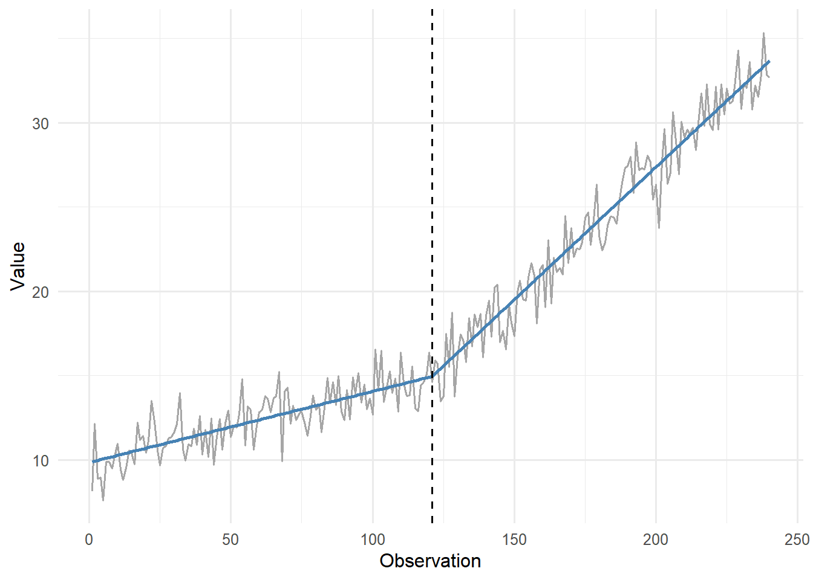{width=672}
:::

```{.r .cell-code}
# Search for an unknown continuous slope break.
trend_scan <- data.frame(first_after = 37:204)
trend_scan$RSS <- vapply(trend_scan$first_after, function(k) {
  d <- mutate(trend_data, candidate_ramp = pmax(0, t - k))
  deviance(lm(y ~ t + candidate_ramp, data = d))
}, numeric(1))
trend_scan[which.min(trend_scan$RSS), ]
```

::: {.cell-output .cell-output-stdout}

```
   first_after      RSS
87         123 360.3132
```


:::

```{.r .cell-code}
ggplot(trend_scan, aes(first_after, RSS)) + geom_line() +
  geom_vline(xintercept = 121, linetype = 2) +
  labs(x = "Candidate first observation after break", y = "RSS")
```

::: {.cell-output-display}
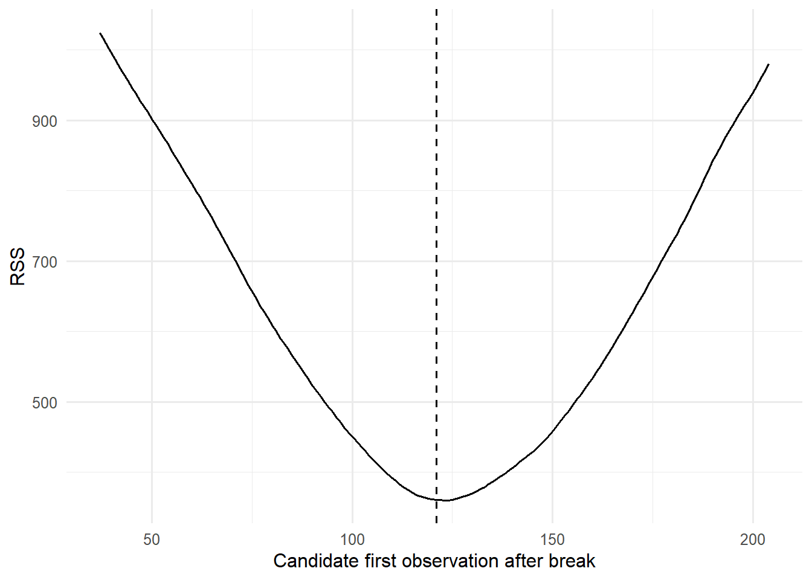{width=672}
:::
:::


**Try:** Add `5 * after` to `true_mean`, regenerate `y`, and refit. Which model now has the smallest BIC? Interpret the pre-break slope and the change in slope separately.

**Your answer:**


::: {.cell}

```{.r .cell-code}
# set seed for reproducibility
set.seed(12)
# creates the data frame trend data where:
# after refers to the inccator variable where 0 is before and 1 is after 
# t = is the trend before the structural change/break
# ramp is the change is the trend, only kicks in after the strucutral break 
trend_data <- data.frame(t = 1:240) |> 
  mutate(
    after = as.integer(t >= 121),
    ramp = pmax(0,t-121),
    true_mean = 10 +0.04*t+5*after+0.12*ramp,
    y = true_mean + rnorm(n(), sd = 1.3)
  )


#regression for each model 
stable <- lm(y~t, data = trend_data)
level <- lm(y~t+after, data = trend_data)
slope <- lm(y~t + ramp , data = trend_data)
both <- lm(y~t + after+ramp , data = trend_data)

#datafram to represemt the performance (BIC) of each model 
data.frame(model = c("Stable trend new", "Level only new", "Slope only new", "Level and slope new"),
           BIC = c(BIC(stable), BIC(level), BIC(slope), BIC(both)))
```

::: {.cell-output .cell-output-stdout}

```
                model       BIC
1    Stable trend new 1160.2668
2      Level only new 1111.1000
3      Slope only new  961.4940
4 Level and slope new  806.0392
```


:::
:::


The level and slope model now has the lowest BIC, while the stable trend model has the highest BIC. This is because the level and slope model aligns more closely with the DGP (data-generating process), since the data was generated with both a level change and a change in trend after the structural break.


::: {.cell}

```{.r .cell-code}
# slope model coefficients
coef(slope)
```

::: {.cell-output .cell-output-stdout}

```
(Intercept)           t        ramp 
 8.55922519  0.07369154  0.11460591 
```


:::

```{.r .cell-code}
# both model coeffecients
coef(both)
```

::: {.cell-output .cell-output-stdout}

```
(Intercept)           t       after        ramp 
 9.78702233  0.04349981  4.79092067  0.11510495 
```


:::
:::


The output for the slope-only model shows the trend before observation 121 and the `ramp`, which represents the change in the trend after the structural break. The output for the level and slope model shows the trend before the break, the `after` coefficient, which represents the immediate change in level at the structural break, and the `ramp`, which represents the change in slope after the break.

The trend coefficient seems to decrease when the `after` component is added to the model, while the ramp coefficient stays relatively similar. This is because the slope-only model does not account for the immediate level change and therefore has to capture the structural change using only the trend and ramp terms. Adding the `after` variable allows the model to separately account for the immediate level change.

The post-break slope for the level and slope model is approximately 0.16. This is calculated by adding the pre-break trend coefficient and the ramp coefficient. Therefore, after the structural break, `y` increases by approximately 0.16 for every additional time period, assuming all other factors remain constant.

## A variance break with no mean change

A mean-break detector is not a variance-break detector. This example has known mean zero and independent Gaussian observations; those assumptions make the likelihood calculation especially simple.


::: {.cell}

```{.r .cell-code}
set.seed(25)
# rule is for observation <150 the standard deviation used is 1 and if greater than this then 3 is used
variance_data <- data.frame(t = 1:300) |>
  mutate(true_sd = ifelse(t <= 150, 1, 3),
         y = rnorm(n(), sd = true_sd), regime = ifelse(t <= 150, "Before", "After"))

# plot of this 
ggplot(variance_data, aes(t, y)) + geom_line() +
  geom_vline(xintercept = 150.5, linetype = 2) +
  labs(x = "Observation", y = "Value")
```

::: {.cell-output-display}
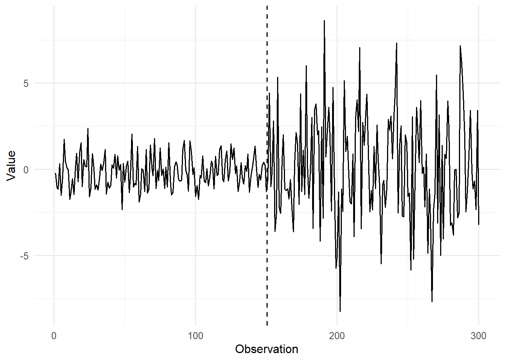{width=672}
:::

```{.r .cell-code}
variance_data |> group_by(regime) |>
  summarise(mean = mean(y), variance = var(y), .groups = "drop")
```

::: {.cell-output .cell-output-stdout}

```
# A tibble: 2 × 3
  regime   mean variance
  <chr>   <dbl>    <dbl>
1 After   0.128    9.82 
2 Before -0.153    0.882
```


:::

```{.r .cell-code}
# Gaussian negative log likelihood, fixing the mean at its known value zero.
# The code below is trying to determine where the break is
variance_nll <- function(y) {
  v <- max(mean(y^2), 1e-12)
  -sum(dnorm(y, mean = 0, sd = sqrt(v), log = TRUE))
}
variance_scan <- data.frame(last_before = 30:270)
variance_scan$nll <- vapply(variance_scan$last_before, function(b) {
  variance_nll(variance_data$y[1:b]) +
    variance_nll(variance_data$y[(b + 1):300])
}, numeric(1))
variance_scan[which.min(variance_scan$nll), ]
```

::: {.cell-output .cell-output-stdout}

```
    last_before      nll
122         151 587.6298
```


:::

```{.r .cell-code}
# plot to show the likelihood
ggplot(variance_scan, aes(last_before + 1, nll)) + geom_line() +
  labs(x = "Candidate first observation after break", y = "Negative log likelihood")
```

::: {.cell-output-display}
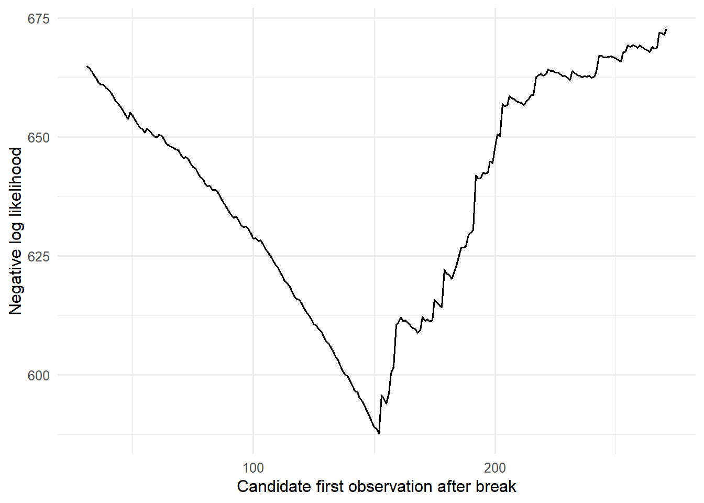{width=672}
:::
:::


**Try:** Reverse the standard deviations, or use a gradual increase. In real data first remove a suitable mean model and inspect residuals and squared residuals. Contrast a single persistent variance shift with recurrent volatility clustering; they need not require the same model.

**Your answer:**

From the code provided, an increase in the standard deviation results in a larger spread of the observations around the mean. This creates a visible structural change in the variability of the series around observation 150.

To reverse the standard deviations, a standard deviation of 3 is assigned to observations before and including observation 150, while a standard deviation of 1 is assigned to observations after observation 150. This is shown in the code below


::: {.cell}

```{.r .cell-code}
variance_data_reverse <- data.frame(t = 1:300) |>
  mutate(true_sd = ifelse(t <= 150, 3, 1),
         y = rnorm(n(), sd = true_sd), regime = ifelse(t <= 150, "Before", "After"))


# plot of reversed
ggplot(variance_data_reverse, aes(t, y)) + geom_line() +
  geom_vline(xintercept = 150.5, linetype = 2) +
  labs(x = "Observation", y = "Value")
```

::: {.cell-output-display}
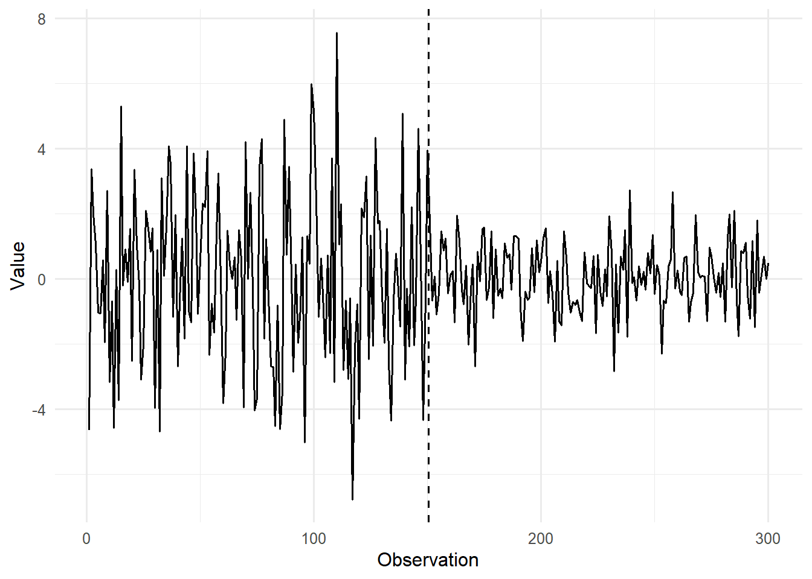{width=672}
:::

```{.r .cell-code}
variance_data |> group_by(regime) |>
  summarise(mean = mean(y), variance = var(y), .groups = "drop")
```

::: {.cell-output .cell-output-stdout}

```
# A tibble: 2 × 3
  regime   mean variance
  <chr>   <dbl>    <dbl>
1 After   0.128    9.82 
2 Before -0.153    0.882
```


:::
:::


The series now starts with a large spread of observations and, after the structural break, the spread becomes smaller. This is expected because the standard deviation decreases from 3 to 1.

To compare the mean and variance before and after the structural break, the following code is run:


::: {.cell}

```{.r .cell-code}
variance_data_reverse |>
  mutate(
    regime = ifelse(t <= 150, "Before", "After")
  ) |>
  group_by(regime) |>
  summarise(
    mean = mean(y),
    variance = var(y),
    sd = sd(y)
  ) |> 
  knitr::kable(, digits = 3, caption = "Change in variance and mean before and after the structural break")
```

::: {.cell-output-display}


Table: Change in variance and mean before and after the structural break

|regime |  mean| variance|    sd|
|:------|-----:|--------:|-----:|
|After  | 0.045|    1.119| 1.058|
|Before | 0.012|    7.280| 2.698|


:::
:::


The mean did change before the mean was smaller and after the structural break the mean became larger. This is makes sense as the observations after the break have less variability than the ones before the break. The variance also did change after the structural break which confirms that the code ran correctly.This confirms that the structural change in this example is primarily a change in variance rather than a change in mean.

The break search code will be run again to determine if the model is able to detect the break


::: {.cell}

```{.r .cell-code}
variance_nll <- function(y) {
  v <- max(mean(y^2), 1e-12)
  
  -sum(
    dnorm(y, mean = 0, sd = sqrt(v), log = TRUE)
  )
}

variance_scan <- data.frame(last_before = 30:270)

variance_scan$nll <- vapply(
  variance_scan$last_before,
  function(b) {
    
    variance_nll(variance_data_reverse$y[1:b]) +
      variance_nll(variance_data_reverse$y[(b + 1):300])
    
  },
  numeric(1)
)

variance_scan[which.min(variance_scan$nll), ]
```

::: {.cell-output .cell-output-stdout}

```
    last_before      nll
122         151 581.9607
```


:::
:::


The function shows that the structural break is at observation 151, which is the same break point as before.

The structural break in the series in this example seems to come from the variance rather than the mean. Although the mean value changed slightly, the magnitude of the change was not very large in comparison to the change in the variance. The small change in the mean can be attributed to random variation, since the data before and after the break were generated with the same underlying mean.

Another thing to note is that the structural break only happens once, as the series moves from one variance regime to another. This is different from volatility clustering, where periods of high and low volatility occur repeatedly over time. If this type of recurring volatility were present in the data, then a volatility modelling approach, such as an ARCH or GARCH model, would be more appropriate for capturing the changing volatility over time.

## A change in seasonal amplitude

Changing seasonality can be missed by a model that only includes a level step.


::: {.cell}

```{.r .cell-code}
set.seed(50)
#series where the seasonality appears every 12 months
seasonal_data <- data.frame(t = 1:240) |>
  mutate(after = as.integer(t >= 121),
         s = sin(2 * pi * t / 12), c = cos(2 * pi * t / 12),
         y = 20 + 0.02 * t + (2 + 4 * after) * s + rnorm(n(), sd = 0.8))

# regression models fitted 
season_stable <- lm(y ~ t + s + c, data = seasonal_data)
season_level <- lm(y ~ t + s + c + after, data = seasonal_data)
season_change <- lm(y ~ t + s + c + after + after:s + after:c,data = seasonal_data)

# data fram of output
data.frame(model = c("Stable season", "Level step", "Season interactions"),
           BIC = c(BIC(season_stable), BIC(season_level), BIC(season_change))) |> 
  knitr::kable(, digits = 3, caption = "Table of BIC for the 3 models")
```

::: {.cell-output-display}


Table: Table of BIC for the 3 models

|model               |     BIC|
|:-------------------|-------:|
|Stable season       | 942.054|
|Level step          | 947.533|
|Season interactions | 602.924|


:::

```{.r .cell-code}
# plot of the series and the break 
seasonal_data$fitted <- fitted(season_change)
ggplot(seasonal_data, aes(t, y)) + geom_line(colour = "grey60") +
  geom_line(aes(y = fitted), colour = "steelblue") +
  geom_vline(xintercept = 121, linetype = 2) + labs(x = "Month", y = "Value")
```

::: {.cell-output-display}
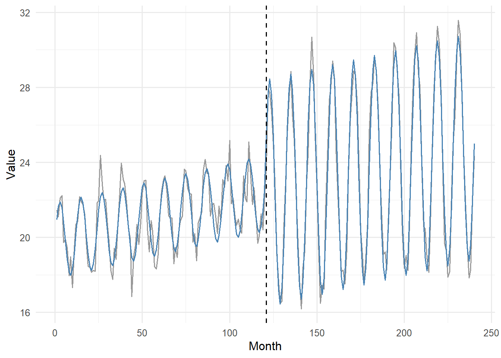{width=672}
:::
:::


**Try:** Replace the post-break wave by a phase-shifted wave. Fit month-factor interactions instead of a single sine/cosine pair. How many extra coefficients does each approach need?

**Your answer:**

From the code provided, the model with seasonal interactions has the lowest BIC, while the level-step model has the highest BIC of the three models.

To answer the question, the post-break seasonal wave will be shifted so that the seasonal peaks occur in different months rather than increasing in amplitude. Therefore, the magnitude of the seasonality will remain the same, but the timing of the peaks and troughs will change. I have decided to shift the seasonality by three months.


::: {.cell}

```{.r .cell-code}
# phase_shift model
seasonal_data_phase_shift <- data.frame(t = 1:240) |>
  mutate(after = as.integer(t >= 121),
         s = sin(2 * pi * t / 12),
         s_after = sin(2 * pi * (t - 3) / 12), # change was applied here
         y = 20 + 0.02 * t +ifelse(after == 0, 2 * s, 2 * s_after) +rnorm(n(), sd = 0.8)
  )


# plot of phase shift
ggplot(seasonal_data_phase_shift, aes(t, y)) +
  geom_line() +
  geom_vline(xintercept = 121, linetype = 2) +
  labs(x = "Observation",y = "y", title = "Plot showing phase shift")
```

::: {.cell-output-display}
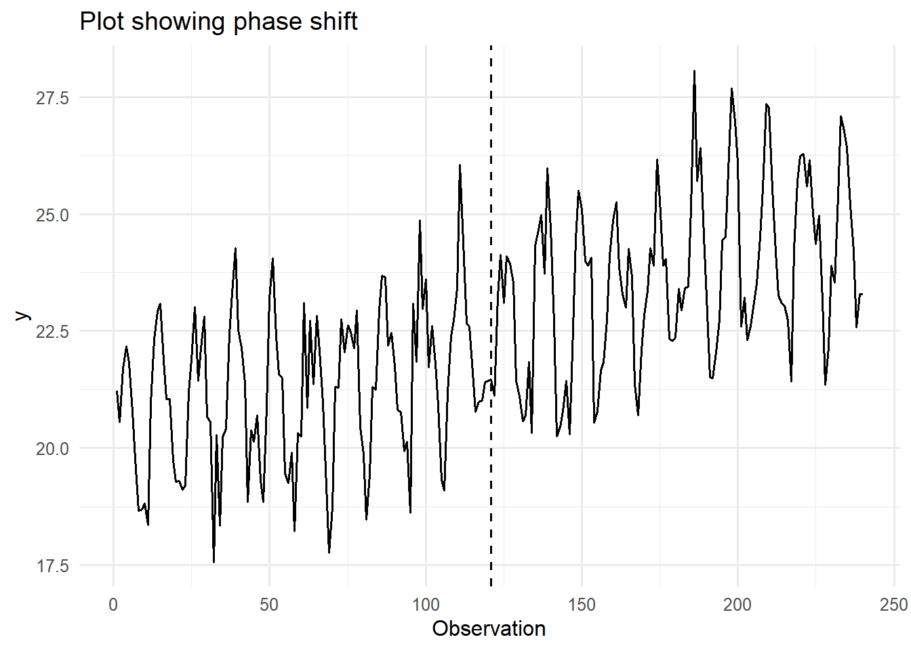{width=672}
:::
:::


The vertical line in the plot indicates the location of the structural break. The change in seasonality is less visually obvious than the previous change in amplitude because the magnitude of the seasonal fluctuations has not changed. Instead, the timing of the peaks and troughs has shifted by three months after the break. There is also an increasing linear trend in the series, which is generated by the `0.02 * t` term.

To determine whether accounting for the structural break better captures the shifted seasonal pattern, month factors are created and two models are compared. The stable-seasonality model assumes that the effect of each month remains the same before and after the structural break. The changing-seasonality model allows the effect of each month to change after the structural break.


::: {.cell}

```{.r .cell-code}
seasonal_data_phase_shift <- seasonal_data_phase_shift |>
  mutate(
    month = factor((t - 1) %% 12 + 1)
  )

# regression models 
month_stable <- lm(y ~ t + month,data = seasonal_data_phase_shift)
month_change <- lm(y ~ t + month + after + month:after,data = seasonal_data_phase_shift)

# model comparison
data.frame(
  model = c("Stable month seasonality","Changing month seasonality"),
  BIC = c(BIC(month_stable),BIC(month_change))
) |> 
  knitr::kable(, digits = 3, caption = "Table showing change BIC of stable seasonality vs shifted seasonality")
```

::: {.cell-output-display}


Table: Table showing change BIC of stable seasonality vs shifted seasonality

|model                      |     BIC|
|:--------------------------|-------:|
|Stable month seasonality   | 856.533|
|Changing month seasonality | 726.702|


:::
:::


The changing-seasonality model had a lower BIC. This means that when there is a shift in the seasonal pattern, detecting and accounting for the structural break allows the series to be fitted more accurately. If the seasonal pattern changes, 11 additional coefficients are required when using monthly factors, as an additional coefficient is needed for each month to capture changes in the monthly effects after the structural break. One month acts as a reference month and that is why only 11 additional coefficients are needed. A sine-cosine approach, however, only requires two additional coefficients to be estimated. Although this approach is more parsimonious, it may not capture complex changes in seasonality as accurately as the monthly-factor approach, which allows the effect of each month to change separately.

## A real policy intervention: Seatbelts

The dataset records monthly drivers killed or seriously injured, not deaths alone. Compulsory seatbelt wearing began on 31 January 1983. Use the supplied `law` variable to encode exposure rather than guessing how the partial month was recorded. [Dataset documentation](https://stat.ethz.ch/R-manual/R-devel/library/datasets/html/UKDriverDeaths.html).


::: {.cell}

```{.r .cell-code}
# data assigined
seat <- as.data.frame(Seatbelts)
seat$date <- seq(as.Date("1969-01-01"), by = "month", length.out = nrow(seat))
seat$t <- seq_len(nrow(seat)) / 12 # general trend over time 
seat$month <- factor(format(seat$date, "%m"), levels = sprintf("%02d", 1:12)) # for seasonality 
seat$log_drivers <- log(seat$drivers) # response var

# plot of series
ggplot(seat, aes(date, drivers)) + geom_line() +
  geom_vline(xintercept = as.Date("1983-02-01"), linetype = 2) +
  labs(x = "Month", y = "Drivers killed or seriously injured")
```

::: {.cell-output-display}
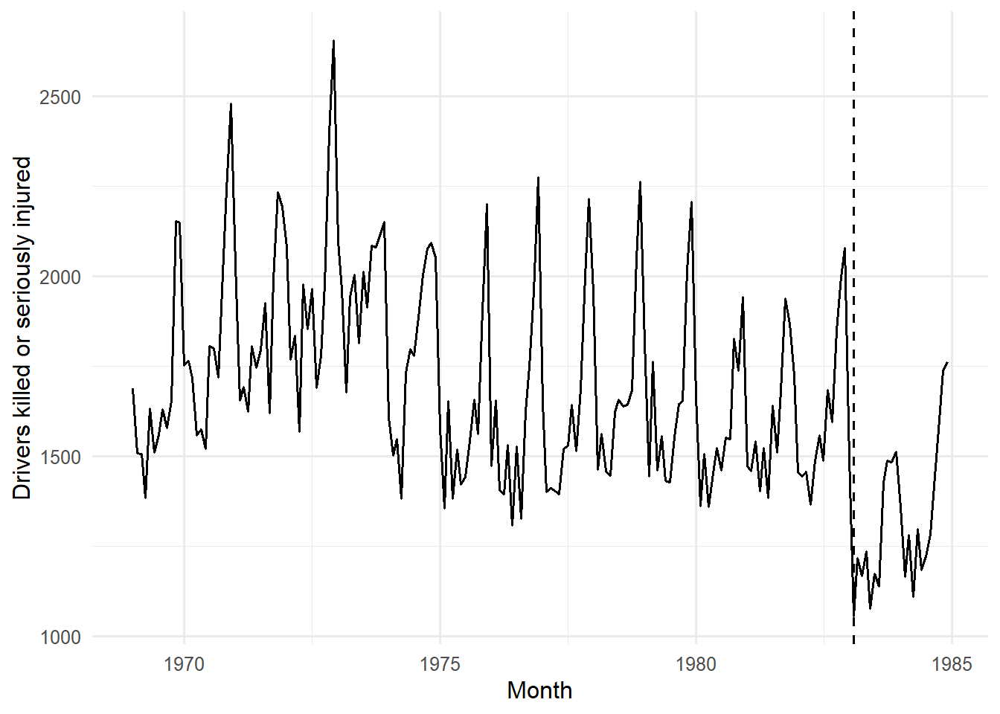{width=672}
:::

```{.r .cell-code}
# ols model
seat_ols <- lm(log_drivers ~ t + month + log(kms) + PetrolPrice + law, data = seat)


# design matrix
X_seat <- model.matrix(~t + month + log(kms) + PetrolPrice + law, seat)[, -1]
seat_ar <- auto.arima(seat$log_drivers, xreg = X_seat,
                     stationary = TRUE, seasonal = FALSE,
                     allowdrift = FALSE, approximation = FALSE)

# data frame of arima coeffecients found 
data.frame(model = c("OLS", "Regression with ARMA errors"),
law_coefficient = c(coef(seat_ols)["law"], coef(seat_ar)["law"]),percentage_change = 100 * expm1(c(coef(seat_ols)["law"],coef(seat_ar)["law"]))) |> 
  knitr::kable(, digits = 3)
```

::: {.cell-output-display}


|model                       | law_coefficient| percentage_change|
|:---------------------------|---------------:|-----------------:|
|OLS                         |          -0.151|           -14.002|
|Regression with ARMA errors |          -0.161|           -14.870|


:::

```{.r .cell-code}
checkresiduals(seat_ar, plot = FALSE) 
```

::: {.cell-output .cell-output-stdout}

```

	Ljung-Box test

data:  Residuals from Regression with ARIMA(2,0,0) errors
Q* = 6.4923, df = 8, p-value = 0.5923

Model df: 2.   Total lags used: 10
```


:::
:::


The percentage calculation is conditional on the controls and model. A date dummy alone does not establish a causal effect. For a simple teaching model, month factors handle fixed seasonality and stationary ARMA errors handle remaining dependence; more elaborate seasonal error models can also be explored.

**Try:** Omit the controls, then omit the trend. Compare estimates and uncertainty. Use `acf(residuals(seat_ols))` and `acf(residuals(seat_ar))` to assess remaining dependence.

**Your answer:**

The first plot has a dotted line showing when the seatbelt law was introduced. The series contains a variable called `law`, which acts as an indicator variable to distinguish between the period before and after the seatbelt law was introduced.

To investigate the effect of including different explanatory variables, three models were fitted: a model containing only the law indicator, a model containing the control variables but no time trend, and the full model containing the time trend and all control variables.


::: {.cell}

```{.r .cell-code}
# only law model 
seat_no_controls <- lm(log_drivers ~ law, data = seat)

# control + law model
seat_no_trend <- lm(log_drivers ~ month + log(kms) + PetrolPrice + law,data = seat)

# full model 
seat_full <- lm(log_drivers ~ t + month + log(kms) + PetrolPrice + law,data = seat)

# table for comparison
data.frame(
  model = c("Law Model","Law + Control Model","Full Model"),
  law_coefficient = c(coef(seat_no_controls)["law"],coef(seat_no_trend)["law"],coef(seat_full)["law"]),
  percentage_change = 100 * expm1(c(coef(seat_no_controls)["law"],coef(seat_no_trend)["law"],coef(seat_full)["law"]))
) |> 
  knitr::kable(
    digits = 3,
    caption = "Law coefficient and estimated percentage change in deaths"
  )
```

::: {.cell-output-display}


Table: Law coefficient and estimated percentage change in deaths

|model               | law_coefficient| percentage_change|
|:-------------------|---------------:|-----------------:|
|Law Model           |          -0.261|           -22.980|
|Law + Control Model |          -0.162|           -14.944|
|Full Model          |          -0.151|           -14.002|


:::
:::


The magnitude of the law coefficient decreases as more explanatory variables are included in the model. Similarly, the estimated percentage change in deaths associated with the introduction of the law becomes smaller as additional variables are controlled for. This suggests that the law-only model may attribute some changes in deaths to the seatbelt law that can also be explained by other factors, such as seasonality, kilometres travelled, petrol prices, and the underlying time trend. However, the difference between the model containing the control variables without a trend and the full model containing the trend is relatively small. This suggests that adding the time trend has only a small additional effect on the estimated law coefficient once the other control variables have already been included.

The residual ACFs of the full OLS model and the regression model with ARMA errors are then compared:


::: {.cell}

```{.r .cell-code}
acf(
  residuals(seat_ols),
  main = "OLS residual ACF"
)
```

::: {.cell-output-display}
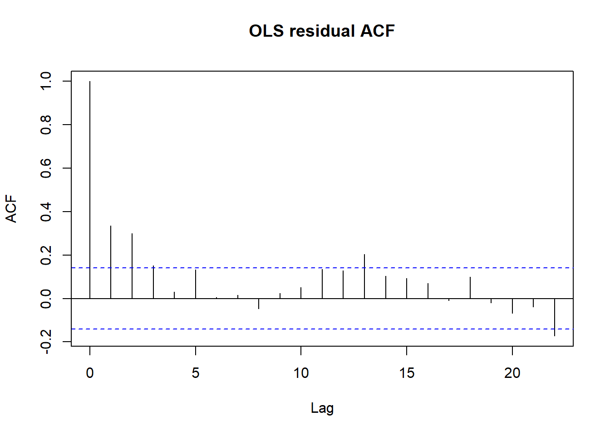{width=672}
:::

```{.r .cell-code}
acf(
  residuals(seat_ar),
  main = "ARMA regression residual ACF"
)
```

::: {.cell-output-display}
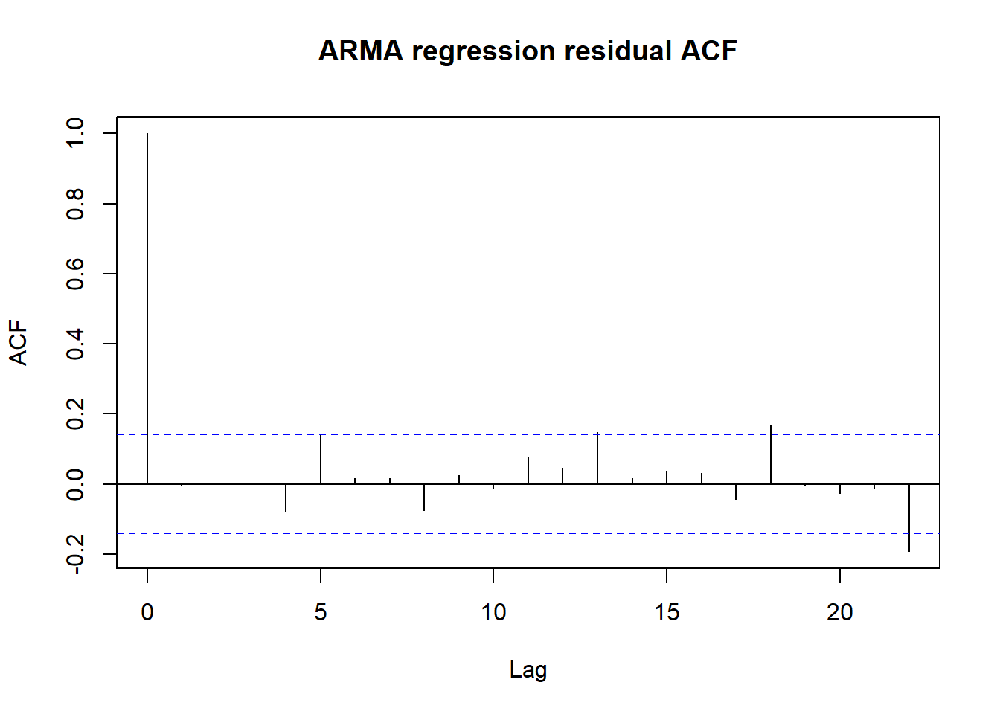{width=672}
:::
:::


The ACF plot for the OLS model shows that there is still autocorrelation in the residuals, with lags 1 and 2 appearing to have significant autocorrelation. This indicates that the explanatory variables in the OLS model do not fully account for the time dependence in the series. In contrast, the residual ACF for the model with ARMA errors shows that most of this autocorrelation structure has been removed.

This highlights the importance for accounting for serial dependence in time series models because even though the other explanatory variables explained variation in deaths time was a factor as well. This was not accounted for in the OLS model but in the ARMA error model it was.

## A transformation before declaring a break: AirPassengers

`AirPassengers` contains monthly international airline passengers in thousands. [Dataset documentation](https://stat.ethz.ch/R-manual/R-devel/library/datasets/html/AirPassengers.html).


::: {.cell}

```{.r .cell-code}
# importing of airpassengers data 
air <- data.frame(date = seq(as.Date("1949-01-01"), by = "month", length.out = 144),
                  passengers = as.numeric(AirPassengers)) |>
  mutate(log_passengers = log(passengers))

#ts plot
air |> pivot_longer(c(passengers, log_passengers)) |>
  ggplot(aes(date, value)) + geom_line() +
  facet_wrap(~name, scales = "free_y", ncol = 1) +
  labs(x = "Month", y = "Value")
```

::: {.cell-output-display}
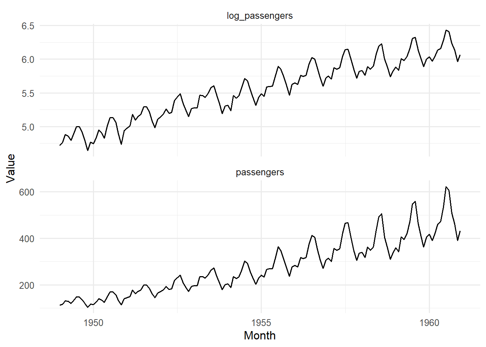{width=672}
:::

```{.r .cell-code}
# strucural decomposition
air_stl <- stl(log(AirPassengers), s.window = "periodic")
air_components <- data.frame(date = air$date, as.data.frame(air_stl$time.series))
#plot 
air_components |> pivot_longer(-date) |>
  ggplot(aes(date, value)) + geom_line() +
  facet_wrap(~name, scales = "free_y", ncol = 1) + labs(x = "Month", y = NULL)
```

::: {.cell-output-display}
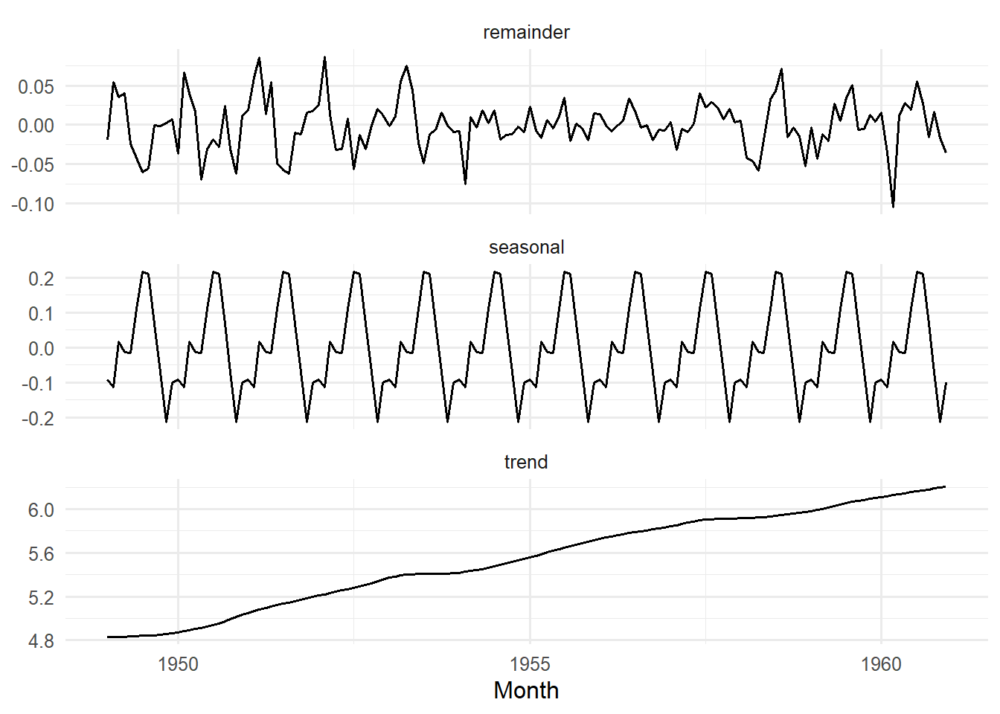{width=672}
:::
:::


Does changing raw-scale seasonal amplitude necessarily imply a structural break? What does the log transformation change?

**Your answer:**

No, I do not think it does. I think this is because of the type of seasonality found in the series. The months in which the peaks occur remain the same; however, the amplitude is different and appears to increase over time based on the plot. This implies that the seasonality is multiplicative. This is confirmed when the series is log-transformed, as the seasonal fluctuations appear to have a more consistent amplitude throughout the series.

The STL plot further confirms this, as the seasonal component of the transformed series appears to follow the same seasonal cycles throughout the dataset, with a relatively consistent amplitude visually.

## Japan visitor arrivals: prepare the data carefully

This section develops your original Japan project. Keep the forecast target as **visitor arrivals**, rather than equating all arrivals with leisure tourists. See [JNTO's definitions](https://statistics.jnto.go.jp/en/faq/). Country coverage and missing categories can change an aggregate; the audit below reports those features. The supplied export has some partially missing months in 1992, 2008 and 2012. For this exploratory exercise, sum the available country counts, preserve the missing-count flag, and call the result an **available-country aggregate**. This is not an assertion that the missing counts were zero. Check against JNTO's published national total before using this as a national-demand model, and repeat the analysis on a reconciled series.


::: {.cell}

```{.r .cell-code}
raw <- read_csv("JNTO - Trends in Visitor Arrivals to Japan.csv", show_col_types = FALSE)
required <- c("Year", "Month (abbr)", "Country/Area", "SUM(Visitor Arrivals)")
stopifnot(all(required %in% names(raw)))
raw <- raw |>
  mutate(month_number = match(sub("\\.$", "", `Month (abbr)`), month.abb),
         date = as.Date(sprintf("%04d-%02d-01", Year, month_number)),
         arrivals = as.numeric(`SUM(Visitor Arrivals)`))
stopifnot(!anyNA(raw$date), all(raw$arrivals >= 0 | is.na(raw$arrivals)))

# A total row plus its component countries would double-count arrivals.
total_rows <- raw |> filter(grepl("^(total|all countries|grand total)$",
                                  trimws(`Country/Area`), ignore.case = TRUE))
stopifnot(nrow(total_rows) == 0)
duplicates <- raw |> count(date, `Country/Area`) |> filter(n > 1)
stopifnot(nrow(duplicates) == 0)

monthly_audit <- raw |> group_by(date) |>
  summarise(countries = n_distinct(`Country/Area`),
            missing_counts = sum(is.na(arrivals)),
            all_missing = all(is.na(arrivals)),
            visitors = if (all_missing) NA_real_ else sum(arrivals, na.rm = TRUE),
            .groups = "drop") |>
  arrange(date)
monthly_audit |> count(countries, missing_counts)
```

::: {.cell-output .cell-output-stdout}

```
# A tibble: 13 × 3
   countries missing_counts     n
       <int>          <int> <int>
 1        31              0    24
 2        58              0     1
 3        58              1    11
 4        61              0    96
 5        71              0    24
 6        84              0    60
 7        86              0    12
 8        87              0     9
 9        87              1     3
10        90              0    24
11       200              0   172
12       200              1     1
13       200            200     7
```


:::

```{.r .cell-code}
monthly_audit |> filter(date >= as.Date("2025-01-01"))
```

::: {.cell-output .cell-output-stdout}

```
# A tibble: 24 × 5
   date       countries missing_counts all_missing visitors
   <date>         <int>          <int> <lgl>          <dbl>
 1 2025-01-01       200              0 FALSE        3781629
 2 2025-02-01       200              0 FALSE        3258491
 3 2025-03-01       200              0 FALSE        3497755
 4 2025-04-01       200              0 FALSE        3909128
 5 2025-05-01       200              0 FALSE        3693587
 6 2025-06-01       200              0 FALSE        3377985
 7 2025-07-01       200              0 FALSE        3437118
 8 2025-08-01       200              0 FALSE        3428406
 9 2025-09-01       200              0 FALSE        3267228
10 2025-10-01       200              0 FALSE        3896524
# ℹ 14 more rows
```


:::

```{.r .cell-code}
# Preserve your draft's May 2026 cutoff; do not infer new data from today's date.
japan <- monthly_audit |> filter(date <= as.Date("2026-05-01"))
stopifnot(!anyNA(japan$visitors),
          identical(japan$date, seq(min(japan$date), max(japan$date), by = "month")))
japan |> filter(missing_counts > 0) |> select(date, countries, missing_counts)
```

::: {.cell-output .cell-output-stdout}

```
# A tibble: 15 × 3
   date       countries missing_counts
   <date>         <int>          <int>
 1 1992-01-01        58              1
 2 1992-02-01        58              1
 3 1992-03-01        58              1
 4 1992-04-01        58              1
 5 1992-05-01        58              1
 6 1992-06-01        58              1
 7 1992-07-01        58              1
 8 1992-08-01        58              1
 9 1992-09-01        58              1
10 1992-10-01        58              1
11 1992-11-01        58              1
12 2008-01-01        87              1
13 2008-02-01        87              1
14 2008-03-01        87              1
15 2012-06-01       200              1
```


:::

```{.r .cell-code}
japan <- japan |> mutate(t = (row_number() - 1) / 12,
                         month = factor(format(date, "%m"), levels = sprintf("%02d", 1:12)),
                         log_visitors = log1p(visitors))
data.frame(first = min(japan$date), last = max(japan$date), months = nrow(japan))
```

::: {.cell-output .cell-output-stdout}

```
       first       last months
1 1990-01-01 2026-05-01    437
```


:::

```{.r .cell-code}
tourist_data <- tsibble::as_tsibble(
  transmute(japan, Month = tsibble::yearmonth(date), Total_Visitors = visitors), index = Month)
tourist_data
```

::: {.cell-output .cell-output-stdout}

```
# A tsibble: 437 x 2 [1M]
       Month Total_Visitors
       <mth>          <dbl>
 1  1990 Jan         246690
 2  1990 Feb         211618
 3  1990 Mar         260054
 4  1990 Apr         288976
 5  1990 May         281982
 6  1990 Jun         253306
 7  1990 Jul         307789
 8  1990 Aug         288141
 9 1990 Sept         282893
10  1990 Oct         316320
# ℹ 427 more rows
```


:::
:::


### Explore levels, seasons and possible regimes

Use March 2020 as an illustrative disruption-window start; it is a modelling choice, not a claim that all restrictions started simultaneously. The reopening marker is October 2022, when independent travel and visa exemptions resumed. [JNTO announcement](https://www.japan.travel/en/us/press-release/japan-to-welcome-international-visitors-beginning-october-11/).


::: {.cell}

```{.r .cell-code}
#ts plot of 2020-2022
ggplot(japan, aes(date, visitors)) + geom_line(colour = "darkgreen") +
  geom_vline(xintercept = as.Date(c("2020-03-01", "2022-10-01")), linetype = 2) +
  labs(x = "Month", y = "Available-country visitor arrivals", title = "Monthly arrivals in the supplied export")
```

::: {.cell-output-display}
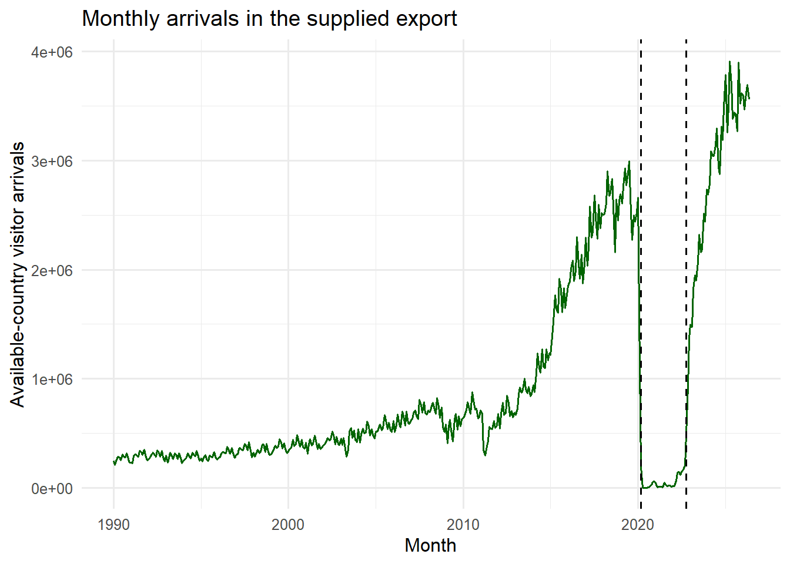{width=672}
:::

```{.r .cell-code}
# Only compare complete years and complete quarters.
annual <- japan |> mutate(year = as.integer(format(date, "%Y"))) |>
  group_by(year) |> summarise(months = n(), visitors = sum(visitors), .groups = "drop")
annual |> filter(months == 12) |>
  ggplot(aes(year, visitors)) + geom_line() + geom_point() +
  labs(x = "Complete year", y = "Annual visitor arrivals")
```

::: {.cell-output-display}
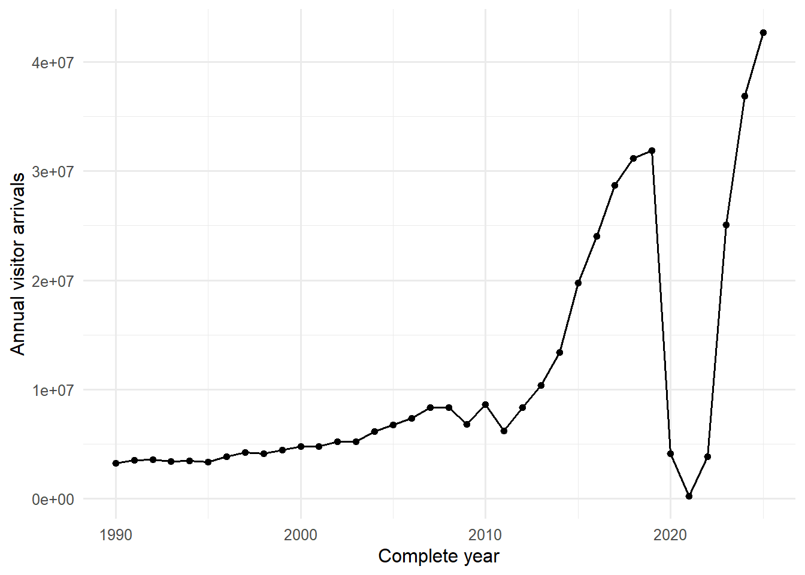{width=672}
:::

```{.r .cell-code}
quarterly <- japan |>
  mutate(quarter = tsibble::yearquarter(date)) |>
  group_by(quarter) |> summarise(months = n(), visitors = sum(visitors), .groups = "drop")
quarterly |> filter(months == 3) |>
  ggplot(aes(as.Date(quarter), visitors)) + geom_line() +
  labs(x = "Complete quarter", y = "Quarterly visitor arrivals")
```

::: {.cell-output-display}
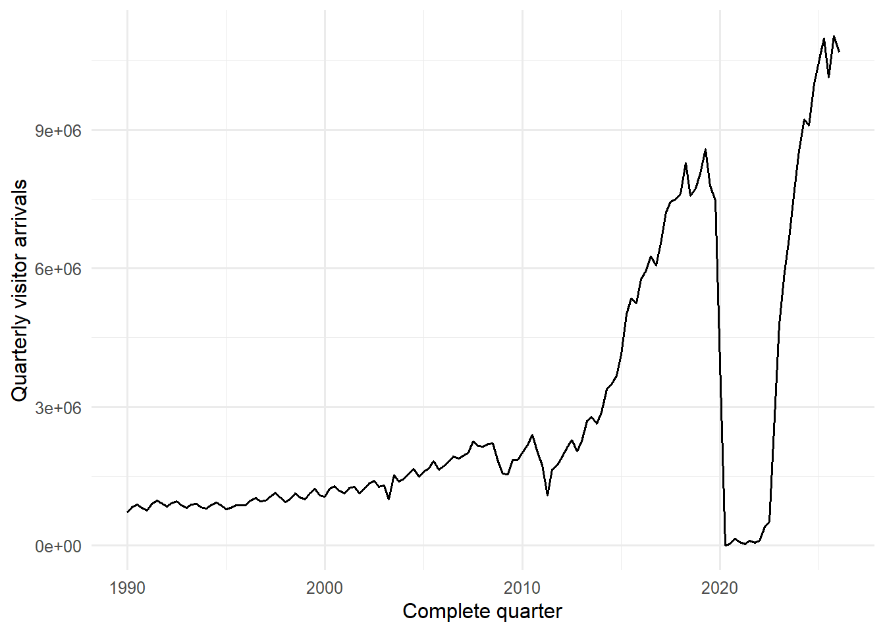{width=672}
:::

```{.r .cell-code}
#plot showing before and after the distruption
japan <- japan |> mutate(regime = case_when(
  date < as.Date("2020-03-01") ~ "Before disruption",
  date < as.Date("2022-10-01") ~ "Disruption window",
  TRUE ~ "After reopening"))
ggplot(japan, aes(month, log_visitors, colour = regime)) +
  geom_boxplot(outlier.size = 0.5) +
  labs(x = "Calendar month", y = "log(1 + arrivals)", colour = "Period")
```

::: {.cell-output-display}
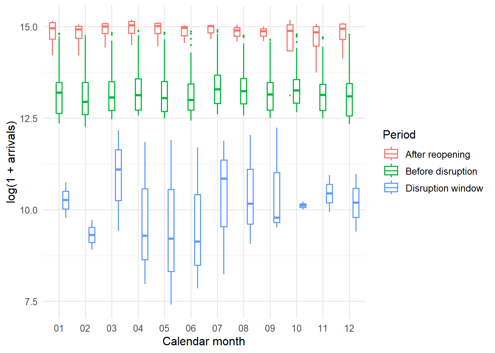{width=672}
:::
:::


Identify candidate level, slope and seasonal changes. Explain why a lower annual total in a partial year would be misleading. Are the seasonal boxplots confounded by long-run growth?

**Your answer:**

From the plots, it looks like there is a temporary structural break in the data. The series did not simply change permanently to a different level, as tourism collapsed during COVID-19 and then recovered after reopening. It is also not a pulse because the disruption lasted for a long period rather than a single observation.

The main candidate break is around 2020, where there is a drastic decline in tourist arrivals. After reopening, there is another change as arrivals increase rapidly, suggesting a change in both the level and slope of the series.

The boxplots also suggest that the seasonal pattern may have changed across the three periods. During the disruption, there is generally greater variation, while after reopening the level of arrivals is much higher. The timing and size of some seasonal peaks also appear different. However, these differences may also be affected by the different overall levels and trends across the three periods.

### Build intervention variables and reserve a test set

Keep the last 12 months out of estimation. The break dates below are pre-specified event-based choices, not dates chosen using the test-set outcomes. A window captures temporary disruption; the reopening step and ramp allow a different subsequent level and growth rate. These are deliberately simple teaching models: one log-linear trend across several decades may be inadequate.


::: {.cell}

```{.r .cell-code}
add_interventions <- function(d) {
  month_id <- as.integer(format(d$date, "%Y")) * 12 +
    as.integer(format(d$date, "%m"))
  d |> mutate(
    disruption = as.integer(date >= as.Date("2020-03-01") & date < as.Date("2022-10-01")),
    reopened = as.integer(date >= as.Date("2022-10-01")),
    recovery_ramp = pmax(0, month_id - (2022 * 12 + 10)) / 12)
}
japan <- add_interventions(japan)
h <- 12
n_train <- nrow(japan) - h
train <- japan[seq_len(n_train), ]
test <- japan[(n_train + 1):nrow(japan), ]
range(train$date)
```

::: {.cell-output .cell-output-stdout}

```
[1] "1990-01-01" "2025-05-01"
```


:::

```{.r .cell-code}
range(test$date)
```

::: {.cell-output .cell-output-stdout}

```
[1] "2025-06-01" "2026-05-01"
```


:::

```{.r .cell-code}
X_base <- function(d) model.matrix(~t + month, d)[, -1, drop = FALSE]
X_break <- function(d) model.matrix(~t + month + disruption + reopened + recovery_ramp,
                                    d)[, -1, drop = FALSE]
fit_regression <- function(d, design) {
  auto.arima(d$log_visitors, xreg = design(d), stationary = TRUE,
             seasonal = FALSE, allowdrift = FALSE, approximation = FALSE)
}
baseline <- fit_regression(train, X_base)
intervention <- fit_regression(train, X_break)
recent_train <- train |> filter(date >= as.Date("2022-10-01"))
stopifnot(nrow(recent_train) >= 24)
recent <- fit_regression(recent_train, X_base)
```
:::


Month factors capture a fixed seasonal shape; ARMA errors handle remaining dependence. Reopening seasonality could instead be allowed to interact with month, but the short recent sample makes that a costly model. All fits above use `log(1 + visitors)` so zeros are allowed.

### Compare out-of-sample forecasts


::: {.cell}

```{.r .cell-code}
prediction_frame <- function(model, future, design, label) {
  p <- forecast(model, xreg = design(future), level = 95)
  data.frame(date = future$date, model = label,
             prediction = pmax(0, expm1(as.numeric(p$mean))),
             lower = pmax(0, expm1(p$lower[, 1])),
             upper = pmax(0, expm1(p$upper[, 1])))
}
predictions <- bind_rows(
  prediction_frame(baseline, test, X_base, "Stable regression"),
  prediction_frame(intervention, test, X_break, "Intervention regression"),
  prediction_frame(recent, test, X_base, "Recent regime"),
  data.frame(date = test$date, model = "Seasonal naive",
    prediction = tail(train$visitors, 12), lower = NA_real_, upper = NA_real_)) |>
  left_join(select(test, date, observed = visitors), by = "date")
scores <- predictions |> group_by(model) |>
  summarise(RMSE = sqrt(mean((observed - prediction)^2)),
            MAE = mean(abs(observed - prediction)),
            coverage95 = if (all(is.na(lower))) NA_real_ else mean(observed >= lower & observed <= upper),
            .groups = "drop") |> arrange(RMSE)
scores
```

::: {.cell-output .cell-output-stdout}

```
# A tibble: 4 × 4
  model                       RMSE      MAE coverage95
  <chr>                      <dbl>    <dbl>      <dbl>
1 Seasonal naive           303011.  264829.         NA
2 Recent regime            864681.  738624.          1
3 Stable regression       1103744.  931639.          1
4 Intervention regression 4547160. 4089922.          1
```


:::

```{.r .cell-code}
# View point forecasts separately so wide intervals do not hide their differences.
ggplot(predictions, aes(date, prediction)) +
  geom_line(colour = "steelblue") +
  geom_line(aes(y = observed), colour = "black") + facet_wrap(~model) +
  labs(x = "Held-out month", y = "Visitor arrivals",
       subtitle = "Point forecasts: black observed, blue predicted median")
```

::: {.cell-output-display}
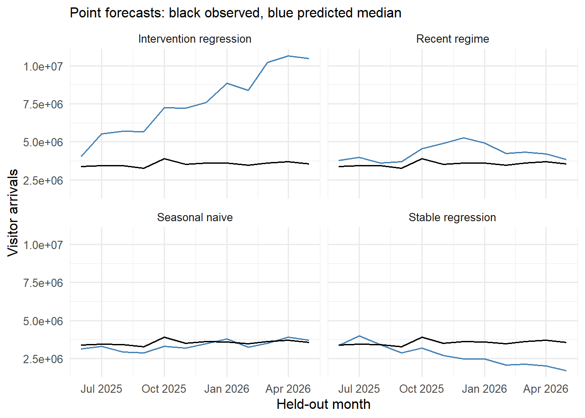{width=672}
:::

```{.r .cell-code}
ggplot(predictions, aes(date, prediction)) +
  geom_ribbon(aes(ymin = lower, ymax = upper), fill = "steelblue", alpha = 0.15, na.rm = TRUE) +
  geom_line(colour = "steelblue") +
  geom_line(aes(y = observed), colour = "black") + facet_wrap(~model) +
  labs(x = "Held-out month", y = "Visitor arrivals",
       subtitle = "Black: observed; blue: prediction and conditional 95% limits")
```

::: {.cell-output-display}
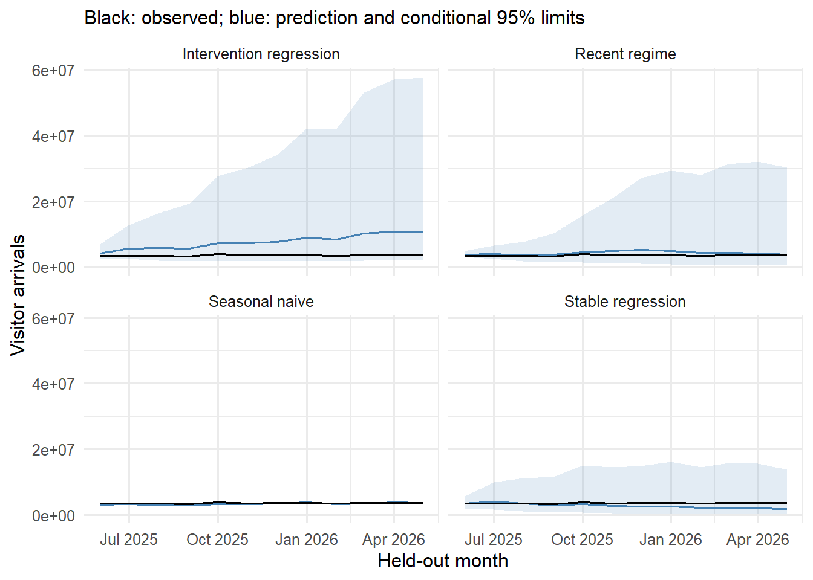{width=672}
:::
:::


The back-transformed predictions are medians under Gaussian log-scale forecasts, not bias-adjusted arithmetic means. RMSE and MAE are therefore comparisons of these particular point forecasts. Interval limits condition on the specified interventions and model; they exclude uncertainty about future breaks. Twelve observations provide a noisy estimate of coverage. Do not compare information criteria across the full-history and recent-only fits: their estimation samples differ.

Which model performs best? Does the recent-only fit lose useful information or avoid an obsolete relationship? Which model would you choose for practical forecasting, and why?

**Your answer:**

The seasonal naïve model performed the best, while the recent-regime model had the second-lowest forecast error. The recent-regime forecast slightly overpredicts the actual values, but the pattern of the series appears to have changed after COVID-19. This suggests that some of the older data may no longer be as relevant for forecasting the current tourism regime.

The intervention model performed the worst, showing that keeping the full history and accounting for the structural changes did not improve forecast performance in this case. The intervention model also had a large prediction interval, and its forecasts increasingly deviated from the actual values.

For practical forecasting, I would choose the recent-regime model despite the seasonal naïve model having the lowest forecast error. The recent-regime model still performed well and focuses on the newer tourism regime, which appears to be more representative of the current behaviour of the series. This supports the idea that fitting the model using the more recent regime can be more useful for forecasting when past relationships have become less relevant.

### Diagnose and forecast under an explicit scenario


::: {.cell}

```{.r .cell-code}
resid_japan <- as.numeric(na.omit(residuals(intervention)))
acf_japan <- acf(resid_japan, plot = FALSE, lag.max = 36)
data.frame(lag = as.numeric(acf_japan$lag)[-1], acf = as.numeric(acf_japan$acf)[-1]) |>
  ggplot(aes(lag, acf)) + geom_col(width = 0.3) +
  geom_hline(yintercept = c(-1, 1) * 1.96 / sqrt(length(resid_japan)), linetype = 2) +
  labs(x = "Lag in months", y = "Residual ACF")
```

::: {.cell-output-display}
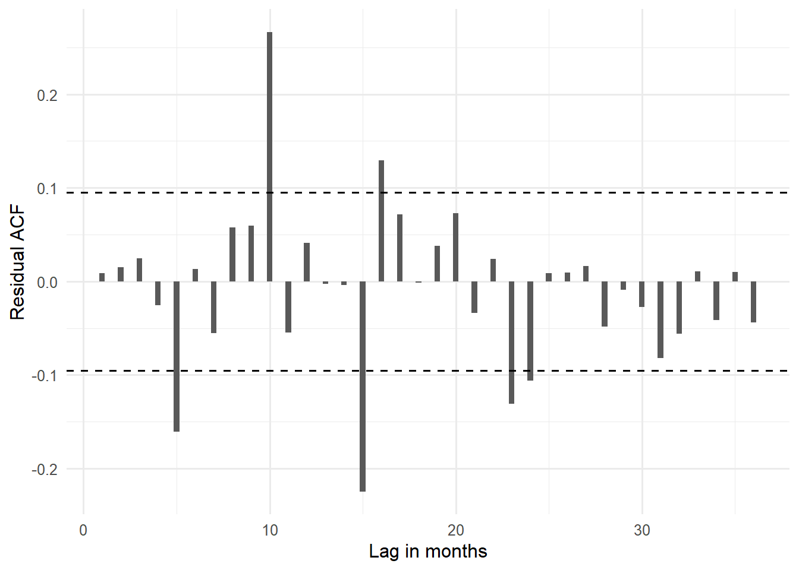{width=672}
:::

```{.r .cell-code}
# Demonstrate the intervention model; this is not automatic winner selection.
final_model <- fit_regression(japan, X_break)
future_dates <- seq(max(japan$date), by = "month", length.out = 13)[-1]
future <- data.frame(date = future_dates,
  t = max(japan$t) + (1:12) / 12,
  month = factor(format(future_dates, "%m"), levels = levels(japan$month))) |>
  add_interventions()
future_forecast <- prediction_frame(final_model, future, X_break, "No new break scenario")
future_forecast
```

::: {.cell-output .cell-output-stdout}

```
         date                 model prediction   lower    upper
1  2026-06-01 No new break scenario    3851859 2263255  6555524
2  2026-07-01 No new break scenario    5206383 2274769 11916121
3  2026-08-01 No new break scenario    5326924 1851432 15326572
4  2026-09-01 No new break scenario    5216561 1545669 17605638
5  2026-10-01 No new break scenario    6595828 1734160 25087030
6  2026-11-01 No new break scenario    6470600 1550442 27004338
7  2026-12-01 No new break scenario    6708855 1493418 30138065
8  2027-01-01 No new break scenario    7706268 1616766 36731678
9  2027-02-01 No new break scenario    7211532 1441858 36068850
10 2027-03-01 No new break scenario    8613296 1655585 44811253
11 2027-04-01 No new break scenario    8856518 1648018 47595271
12 2027-05-01 No new break scenario    8585001 1555254 47389182
```


:::

```{.r .cell-code}
ggplot(tail(japan, 60), aes(date, visitors)) + geom_line() +
  geom_ribbon(data = future_forecast,
              aes(x = date, ymin = lower, ymax = upper), inherit.aes = FALSE,
              fill = "steelblue", alpha = 0.2) +
  geom_line(data = future_forecast, aes(date, prediction), colour = "steelblue") +
  labs(x = "Month", y = "Visitor arrivals", title = "Forecast conditional on no new intervention")
```

::: {.cell-output-display}
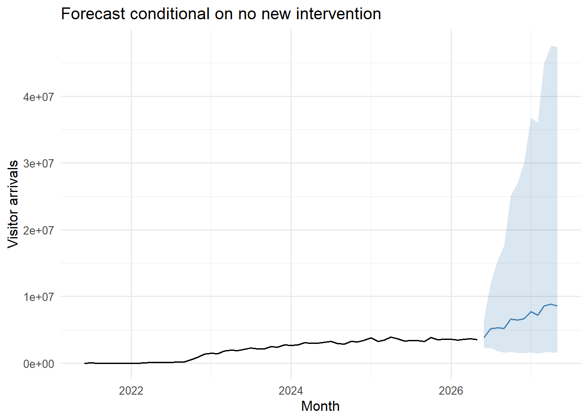{width=672}
:::
:::


What assumptions do the future intervention columns encode? How would the forecast change if recovery growth flattened? What would happen if a new restriction occurred?

**Your answer:**

Different future scenarios would need to be encoded depending on whether the disruption ends, the reopened regime continues, and whether the recovery ramp continues or flattens.

The residual ACF shows that there is still significant autocorrelation, suggesting that the model has not captured all of the time dependence in the series. If recovery flattened, the upward trend in the forecast would also flatten.

If a new disruption occurred while the model still assumed that reopening and recovery continued, it could incorrectly forecast increasing arrivals. Therefore, a new structural change would require the intervention variables to be updated to represent the new regime and the recovery ramp to be stopped or adjusted.

# Reflection

Through this tutorial, I learnt how to recognise structural breaks visually and how to represent them using intervention variables in regression models. My main learning was that a structural break does not only mean a sudden change in the mean. It can also involve changes in the trend, variance, seasonality or the overall regime of a time series. I also learnt to distinguish between a one-time structural break in variance and changing volatility, where periods of high and low variance occur repeatedly over time.

I found the Japan tourist arrivals example the most informative because it showed me how structural breaks matter in practice. The COVID-19 disruption was followed by a different tourism regime, and using older data did not necessarily improve the forecasts. This helped me understand that identifying a structural break is not only about improving model fit, but also about deciding whether historical relationships are still relevant for forecasting.

If I had more time, I would explore R packages that automatically detect structural breaks and investigate how structural changes could be incorporated into other approaches, particularly state-space models.

## References

- [Forecasting: Principles and Practice, regression and intervention variables](https://otexts.com/fpp3/regression.html).
- [strucchange: dating regression breaks](https://search.r-project.org/CRAN/refmans/strucchange/html/breakpoints.html).
- Dataset and JNTO links appear alongside the relevant examples.
