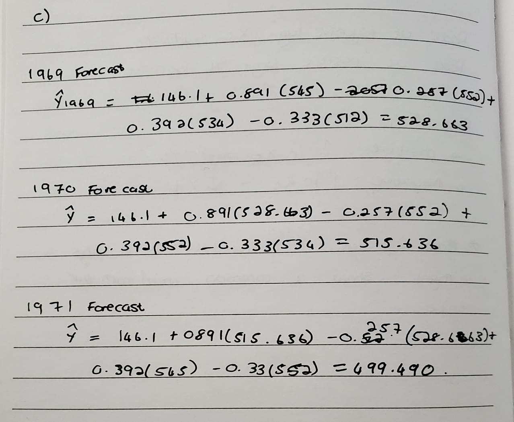

```{r}

# libraries
library(forecast)
```

## Question 1

Problem definition: Define the specific objective, which is forecasting the future sales volume for the manufacturer's various biscuit products. This involves determining the forecasting horizon and how the business will use these forecasts, such as for ordering raw ingredients, scheduling factory shifts, or managing warehouse inventory.

Data collection: Gather the historical sales data for all the different biscuit product lines. This step also involves collecting relevant explanatory variables that drive demand, such as past marketing promotions, holiday schedules, pricing changes, or competitor actions.

Data analysis: Explore the historical biscuit sales data visually and statistically to identify underlying patterns. This includes checking for seasonality, long-term trends, and identifying or cleaning any missing records or outliers.

Model selection and fitting: Choose appropriate forecasting methods based on the data patterns and estimate the model parameters using the historical sales data for each biscuit type. As the diagram shows, this step may loop back to data analysis if the initial models don't fit well.

Model validation: Evaluate how accurately the chosen models predict future sales before relying on them. This involves splitting the historical biscuit data into a training set and a hold-out test set to calculate forecast accuracy metrics and checking the residuals to ensure the model has captured all the available information.

Forecasting model deployment: Implement the finalized forecasting models into the biscuit manufacturer's IT infrastructure. This allows supply chain managers and production planners to automatically generate and access the sales forecasts for their operational planning.

Monitoring forecasting model performance: Continuously track the accuracy of the forecasts by comparing the predicted biscuit sales against the actual sales data as new data becomes available. If the forecast errors begin to widen over time the thus the models will need to be re-evaluated and updated.

## Question 2

For each of the following series, what sort of time patterns would you expect to see?

a)  Monthly sales of computer hard drives for the past 10 years at your local store.

I would expect to see seasonal patterns that repeat annually, I would also expect to see some sort of trend presenting the long term change in sales over time.

b)  Hourly pulse rate of a person for one week.

I would expect to see some sort of seasonality for certain hours of in regards to pulse rate, such as when there is sleep. However, a week may not be long enough to indicate any sort of trend in the data

c)  Daily sales at a fast-food store for six months I would expect to see weekly seasonality where certain days in the week have a patter in the daily sales orders.

d)  Weekly electricity consumption for your local area over the past 10 years. I would expect distinct consumption peaks during the winter months driven by heating demands, and lower consumption during the milder shoulder seasons.

## Question 3

| Time Series Plot | ACF Plot | Reasoning |
|:---------------------|:--------------------------:|:---------------------|
| 1\. Daily morning temperature of a cow | B | The series wanders randomly without a distinct repeating period. ACF B matches this by showing a slow, smooth decay, which is typical for highly autocorrelated data with no seasonality. |
| 2\. Accidental deaths in USA (monthly) | A | There is a strong, consistent monthly seasonality but no overall trend. ACF A shows this stationary seasonal pattern perfectly, with clear spikes every 12 lags. |
| 3\. International airline passengers | D | The plot shows a strong upward trend combined with monthly seasonality. ACF D matches this because the strong trend causes the ACF to decay very slowly overall, while the seasonality creates the small bumps along the decay. |
| 4\. Annual mink trappings (Canada) | C | This series exhibits a long cycle (roughly 10 years between peaks) rather than fixed monthly seasonality. ACF C reflects this cyclical behavior, as the autocorrelation oscillates and peaks around lag 10. |

## Question 4

```{r}
# data 
knives_sales <- c(19, 15, 39, 102, 90, 29, 90, 46, 30, 66, 80, 89, 82, 17, 26, 29)
n <- length(knives_sales)
```

### 4a)

```{r}
 
k_values <- c(3, 5, 7, 9, 11)
forecasts_May92 <- sapply(k_values, function(k) {
  mean(tail(knives_sales, k))
})
names(forecasts_May92) <- paste0("MA_", k_values)
forecasts_May92
```

### 4b)

```{r}
# initializing matrix to store 
max_k <- n - 1
mse_values <- numeric(max_k)

# loop to calculate mse for eacj value of k
for (k in 1:max_k) {
  errors <- numeric(n - k)
  for (t in (k + 1):n) {
    
    fc =  mean(knives_sales[(t - k):(t - 1)])
    errors[t - k] <- knives_sales[t] - fc
  }
  mse_values[k] <- mean(errors^2)
}

optimal_k <- which.min(mse_values)
optimal_k
```

15 should be chosen

## Question 5

```{r}
# Loading the data
souvenir_data <- c(
  1664.81, 2397.53, 2840.71, 3547.29, 3752.96, 3714.74, 4349.61, 3566.34, 5021.82, 6423.48, 7600.6, 19756.21,
  2499.81, 5198.24, 7225.14, 4806.03, 5900.88, 4951.34, 6179.12, 4752.15, 5496.43, 5835.1, 12600.08, 28541.72,
  4717.02, 5702.63, 9957.58, 5304.78, 6492.43, 6630.8, 7349.62, 8176.62, 8573.17, 9690.5, 15151.84, 34061.01,
  5921.1, 5814.58, 12421.25, 6369.77, 7609.12, 7224.75, 8121.22, 7979.25, 8093.06, 8476.7, 17914.66, 30114.41,
  4826.64, 6470.23, 9638.77, 8821.17, 8722.37, 10209.48, 11276.55, 12552.22, 11637.39, 13606.89, 21822.11, 45060.69,
  7615.03, 9849.69, 14558.4, 11587.33, 9332.56, 13082.09, 16732.78, 19888.61, 23933.38, 25391.35, 36024.8, 80721.71,
  10243.24, 11266.88, 21826.84, 17357.33, 15997.79, 18601.53, 26155.15, 28586.52, 30505.41, 30821.33, 46634.38, 104660.67
)
souvenir_ts <- ts(souvenir_data, start = c(1987, 1), frequency = 12)
```

### 5a) Produce a time plot of the data and describe the patterns in the graph. Identify anyunusual or unexpected fluctuations in the time series

```{r}
plot(souvenir_ts, main="Monthly Souvenir Sales (1987-1993)", ylab="Sales", xlab="Year", col="blue", lwd=2)
```

The seasonality in the dataset seems to grow with time. In represents that the monthly sales seasonality might be multiplicative and a possible transformation of the data is required.

### 5b) Explain why it is necessary to take logarithms of these data before fitting a model. Taking the logarithms of the data is necessary to stabilize the variance. Because the time plot shows the seasonal swings growing wider as the overall level of the data increases, the seasonality is multiplicative. A log transformation converts this into additive seasonality, ensuring the seasonal fluctuations remain roughly constant over time. This is required because standard time series models, like ARIMA, assume constant variance and seasonal effects.

### 5c) Calculate total sales each year and find the logarithms of these sales. Plot these against the year and fit a linear regression line to these data.

```{r}

years <- seq(1987, 1993)
yearly_totals <- tapply(souvenir_data, rep(years, each = 12), sum)


log_yearly_totals <- log(yearly_totals)


sales_lm <- lm(log_yearly_totals ~ years)


plot(years, log_yearly_totals, main="Log of Annual Total Sales vs Year", 
     xlab="Year", ylab="Log(Total Sales)", pch=16, col="darkred")
abline(sales_lm, col="blue", lwd=2)
```

### 5d) Use your regression model to predict the logarithm of the total annual sales for 1994,1995, and 1996. Produce prediction intervals for each of your forecasts.

```{r}
future_years <- data.frame(years = c(1994, 1995, 1996))
log_fc <- predict(sales_lm, newdata = future_years, interval = "prediction", level = 0.95)
forecast_table <- data.frame(Year = future_years$years, log_fc)
forecast_table
```

### 5e) Transform your predictions and intervals to obtain predictions and intervals for the raw data.

```{r}
raw_fc <- exp(log_fc)
forecast_table_raw <- data.frame(Year = future_years$years, raw_fc)
forecast_table_raw
```

## Question 6

A classic example of a non-stationary series is the daily closing IBM stock prices.Figure 3 shows the analysis of n = 369 daily closing prices for IBM stock. Explain how eachplot shows the series is non-stationary and should be differenced.

The first plot shows periods of high closing prices followed by periods of low closing prices, wandering without a stable baseline, which indicates the mean is not constant over time. The ACF plot shows persistence in the effect of past lags on the current price value, with the spikes decaying very slowly rather than quickly dropping to zero. This slow decay confirms the series is non-stationary. Finally, the PACF plot shows almost a 1 autocorrelation with the previous closing price, meaning that the current price is heavily based on the previous day's closing price. Together, these plots show the series closely follows a random walk and needs to be differenced to make it stationary.

## Question 7

```{r}
# data
strikes_data <- c(4737, 5117, 5091, 3468, 4320, 3825, 3673, 3694, 3708, 3333, 
                  3367, 3614, 3362, 3655, 3963, 4405, 4595, 5045, 5700, 5716, 
                  5138, 5010, 5353, 6074, 5031, 5648, 5506, 4230, 4827, 3885)
strikes_ts <- ts(strikes_data, start = 1951)
```

### 7a) By studying appropriate graphs of the series, explain why an ARIMA(0,1,1) model seems appropriate.

```{r}

diff_strikes <- diff(strikes_ts)

par(mfrow=c(2,2))
plot(strikes_ts, main="Original Strikes Series (1951-1980)", ylab="Number of Strikes")
plot(diff_strikes, main="Differenced Series (d=1)", ylab="Differenced Data")
acf(diff_strikes, main="ACF of Differenced Series")
pacf(diff_strikes, main="PACF of Differenced Series")
par(mfrow=c(1,1))
```

The original strikes series plot shows a wandering mean, indicating the data is non-stationary and requires first-order differencing d = 1. The differenced series plot shows the data now fluctuates around a constant mean of zero, confirming stationarity has been achieved. The ACF plot of the differenced series has a single significant negative spike at lag 1 and then cuts off, which indicates a Moving Average order of 1 q = 1. The PACF plot tails off gradually, indicating an Autoregressive order of 0 p = 0. Because the series required one difference and the differenced data exhibits an MA(1) signature, an ARIMA(0,1,1) model is appropriate.

### 7b) Write this model in terms of the backshift operator.

$$(1 - B)Y_t = (1 + \theta_1 B)\epsilon_t$$

Where:

- $Y_t$ is the number of strikes at time $t$.
- $(1 - B)$ represents the first-order differencing operator ($d=1$).
- $(1 + \theta_1 B)$ represents the moving average component of order 1 ($q=1$).
- $B$ is the backshift operator, defined such that $BY_t = Y_{t-1}$.
- $\epsilon_t$ is the white noise error term.

### 7c)

```{r}

strikes_model <- arima(strikes_ts, order = c(0, 1, 1))
print(strikes_model)


par(mfrow=c(1,2))
plot(residuals(strikes_model), main="Residuals of ARIMA(0,1,1)", ylab="Residuals")
acf(residuals(strikes_model), main="ACF of Residuals")
par(mfrow=c(1,1))


Box.test(residuals(strikes_model), type = "Ljung-Box", lag = 10)
```

Ljung-Box test yielded a large p-value, which confirms that there is no remaining autocorrelation and that the ARIMA(0,1,1) model has adequately captured the dependence in the data. The acf plot of the residuals also shows no significant lags

### 7d) Forecast three times ahead by hand. Check your forecasts with forecasts generatedusing R.

```{r}

last_Y <- tail(strikes_ts, 1)
last_residual <- tail(residuals(strikes_model), 1)
theta_1 <- coef(strikes_model)["ma1"]


r_forecasts <- forecast(strikes_model, h = 3)
r_forecasts
```

### 7e) Create a plot of the series with forecasts and prediction intervals for the next three periods shown.

```{r}
plot(r_forecasts, main="Forecasts from ARIMA(0,1,1) for US Strikes", 
     xlab="Year", ylab="Number of Strikes", 
     fcol="blue", shaded=TRUE)
```

## Question 8

8a) The equation represents an ARIMA(4,0,0) model. The series is modeled using four autoregressive lags p = 4, is not differenced d = 0, and contains no moving average terms q = 0.

8b) The PACF plot shows significant spikes at lags 1 and 4 before cutting off, while the ACF plot decays gradually. The combination of a tailing-off ACF and a PACF cutting off after 4 lags indicates an Autoregressive process of order 4, making an ARIMA(4,0,0) model appropriate.

8c) 
{#fig-label width="75%"}

# Reflection

This tutorial helped me connect the stages of a time series analysis, from defining the forecasting problem and exploring patterns to fitting models and checking residuals. The souvenir-sales example made the role of a log transformation clearer, particularly when seasonal fluctuations increase with the level of the series.

The strikes example helped me connect differencing and ACF/PACF patterns to a candidate ARIMA model. Writing the model using the backshift operator also helped link the notation to its implementation in R. I learnt that plots and diagnostic tests provide evidence for modelling decisions, rather than proving that a model is correct.

My next steps are to complete the hand-calculated forecasts and improve the moving-average comparison by evaluating each window size over the same forecast periods. I would also like more practice interpreting prediction intervals and checking forecasts on the original scale after transformation.
